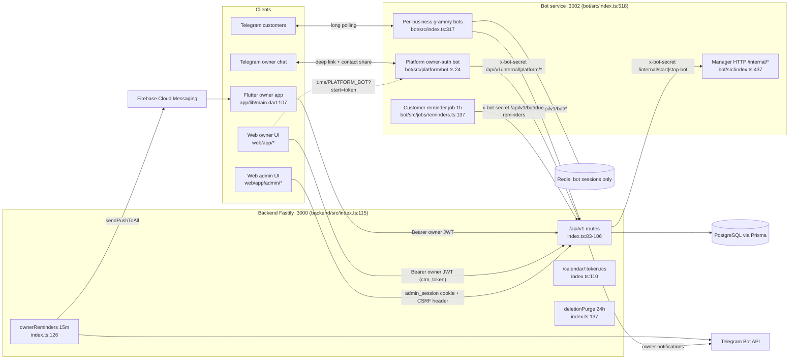

# Architecture

Audience: internal
Last updated: 2026-07-03
Verified against: 64a177a

---

Dealio is one backend serving three client surfaces (a Telegram bot service, a Next.js web app, and a Flutter mobile app), backed by PostgreSQL (via Prisma) and Redis (bot sessions only), and talking outward to the Telegram Bot API and Firebase Cloud Messaging. This document is a system overview: surfaces, how they talk, the auth on each hop, and the multi-tenancy model. For per-route detail see [FUNCTIONALITY_INVENTORY.md](FUNCTIONALITY_INVENTORY.md).

## The four surfaces

| Surface | Tech | Entry point | Evidence |
|---|---|---|---|
| Backend API | Node.js + Fastify + TypeScript | `bootstrap()` registers plugins and routes, then `app.listen({ port, host: '0.0.0.0' })` | backend/src/index.ts:69, 114-115 |
| Telegram bot service | Node.js + Grammy + Express (manager HTTP) | `main()` starts the Express manager server, the platform bot, then one grammy bot per business | bot/src/index.ts:443, 518 |
| Web (owner + admin + public) | Next.js 14 App Router | No custom server. Root layout plus `app/**/page.tsx`. The admin panel is the SAME app under `/admin/*`, not a separate service | web/app/layout.tsx; web/app/admin/login/page.tsx |
| Flutter mobile app (owner) | Flutter + Riverpod + Dio | `void main()` runs `assertReleaseConfig()`, Firebase init, then `runApp` | app/lib/main.dart:107, 110, 123 |

The bot service is really two processes-in-one: an Express "manager" HTTP server on port 3002 that starts/stops bots on command (bot/src/index.ts:356-441), and the grammy long-polling bots themselves. There is one central platform bot for owner enrollment plus one bot per onboarded business (bot/src/index.ts:66-94, 287-341).

## URL prefix and root routes

All 24 route modules are registered with `{ prefix: '/api/v1' }` (backend/src/index.ts:83-106). Exactly two routes live at the root, deliberately un-prefixed:

- `GET /calendar/:token.ics` is the ICS subscription feed, kept short so the URL stays copy-pasteable (backend/src/index.ts:108-110).
- `GET /health` is the liveness probe (backend/src/index.ts:112).

Clients bake the prefix in differently: Flutter puts `/api/v1` in its base URL, web reads `NEXT_PUBLIC_API_URL` and uses prefix-less paths in code, and the bot uses `BACKEND_URL` without the prefix and hardcodes `/api/v1/...` into every path (bot/src/lib/api.ts:89). No client ever calls the bot service directly; only the backend does (see matrix below).

## Communication paths and auth

There are four distinct auth mechanisms in play. Which one a call carries is fixed by the hop, not the endpoint:

- **Owner JWT (Bearer).** Signed with `JWT_SECRET`, default expiry 30d. Verified by the `authenticate` preHandler via `request.jwtVerify()` (backend/src/middleware/auth.ts:3-9). Web attaches it from a JS-readable `crm_token` cookie via an axios interceptor; Flutter attaches it via a Dio interceptor. Impersonation JWTs additionally carry `isImpersonation: true` and are write-fenced globally by `impersonationGuard` (backend/src/index.ts:63).
- **Admin auth (httpOnly cookie + CSRF header).** The `admin_session` cookie (httpOnly, sameSite strict, `path: /api/v1/admin`, 8h) holds an admin JWT signed with `ADMIN_JWT_SECRET`. Checked by `requireAdmin` (backend/src/middleware/adminAuth.ts:26-58). Every mutating `/api/v1/admin/*` request must also carry `x-requested-with: dealio-admin`, enforced by `adminCsrfGuard`, a global onRequest hook (backend/src/index.ts:67).
- **Bot-internal shared secret.** Header `x-bot-secret` = `BOT_MANAGER_SECRET`, used in both directions and checked with `timingSafeEqual` on `/bot/*` (backend/src/routes/bot.ts:17-26), `/internal/*` (backend/src/routes/internal.ts:9-18), and the manager's Express endpoints (bot/src/index.ts:345-354).
- **Capability tokens.** Random-token URLs that stand in for a session: the ICS calendar token, the single-use proposal `acceptToken` (backend/src/routes/proposals.ts:61-90), and the one-time owner enrollment deep-link token (`t.me/<PLATFORM_BOT>?start=<token>`, backend/src/routes/auth.ts:89-91).

| From, To | Base URL (source) | Auth | Checked at |
|---|---|---|---|
| Web owner, Backend | `NEXT_PUBLIC_API_URL` | Owner JWT Bearer (from `crm_token`) | backend/src/middleware/auth.ts:3-9 |
| Web admin, Backend | `NEXT_PUBLIC_API_URL` | `admin_session` cookie + `x-requested-with` CSRF header | backend/src/middleware/adminAuth.ts:18-58 |
| Flutter, Backend | `API_BASE_URL` dart-define | Owner JWT Bearer | backend/src/middleware/auth.ts:3-9 |
| Bot service, Backend | `BACKEND_URL` (default `http://localhost:3000`) | `x-bot-secret` | backend/src/routes/bot.ts:17-26; internal.ts:9-18 |
| Backend, Bot manager | `BOT_SERVICE_URL` (default `http://localhost:3002`) | `x-bot-secret` | bot/src/index.ts:345-354 |
| Backend, Telegram Bot API | `https://api.telegram.org/bot<token>/...` | per-business token (decrypted server-side) or `PLATFORM_BOT_TOKEN` | backend/src/lib/telegram.ts:7-17 |
| Backend, FCM | firebase-admin SDK | `FCM_SERVICE_ACCOUNT_JSON` service account | backend/src/lib/push.ts:4-32 |
| Bot, Telegram | grammy long polling (no webhooks anywhere) | per-business token via `POST /internal/get-bot-token` | bot/src/index.ts:317-325 |
| Flutter/Web, Bot service | NOT FOUND (neither client calls the bot directly) | n/a | n/a |

Both the backend and the bot run their own background schedulers on plain `setInterval` with no cron library and no `NODE_ENV` guard: owner reminders every 15 min and a deletion purge every 24h on the backend (backend/src/index.ts:126-141), and a customer-facing reminder job every 1h per bot (bot/src/index.ts:307).

## Multi-tenancy model

Tenancy is single-database, row-scoped by `businessId`, with two independent enforcement chokepoints, one per auth mechanism.

**Owner and admin side: `getBusinessOrFail`.** Every owner route funnels through `getBusinessOrFail(request, reply)`, which resolves the business by `ownerId` from the JWT, returns 404 if the caller has no business, and 403 `ACCOUNT_SUSPENDED` if the business is suspended (with an exemption for admin impersonation so support can still read a suspended account). Callers pattern-match `if (!business) return;` so a null return halts the handler (backend/src/lib/businessFromUser.ts:23-49). Because this one function both resolves the tenant and enforces suspension, an owner can never reach another business's rows through an owner-JWT route.

**Bot side: `botUsername` in the path plus the shared secret.** There is one Telegram bot per business. Bot-internal calls do not carry a per-tenant credential; they carry the single global `x-bot-secret` and name the tenant by putting the bot's `@handle` in the request body/path. The backend resolves it via `findBusinessByUsername`, which looks the business up by its unique `botUsername` (backend/src/routes/bot.ts:28-36). So on the `/bot/*` surface, tenant isolation rests on (1) the shared secret proving the caller is the trusted bot service and (2) the `botUsername` selecting the row. The session store is namespaced the same way: keys are `businessId:chatId`, because in private chats the Telegram user id is identical across every business's bot and would otherwise let one user's cart bleed across businesses (bot/src/index.ts:132-141).

## Topology

## Related audits

Deeper cross-cutting analyses live alongside this document and in `docs/`:

- Authorization and tenant isolation: [../AUTHORIZATION_AUDIT.md](../AUTHORIZATION_AUDIT.md)
- Admin panel and impersonation: [../ADMIN_AUDIT.md](../ADMIN_AUDIT.md)
- Data compliance: [audits/DATA_COMPLIANCE_AUDIT.md](audits/DATA_COMPLIANCE_AUDIT.md)
- Redis session handling: [audits/REDIS_SESSION_AUDIT.md](audits/REDIS_SESSION_AUDIT.md)
- Account deletion and purge: [audits/DELETION_AUDIT.md](audits/DELETION_AUDIT.md)
