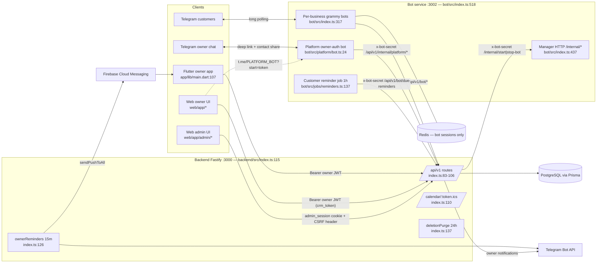

# Dealio — Functionality Inventory (ground truth from code)

| | |
|---|---|
| **Date** | 2026-07-03 |
| **Commit** | `64a177a` (`git rev-parse --short HEAD`) — plus uncommitted working-tree changes noted in §C.5 and §J |
| **Method** | Code-first audit. Every claim cites `file:line`. CLAUDE.md, docs/spec.md (which does not exist) and the five audit reports in `docs/` were treated as untrusted; where they conflict with code, code wins. `NOT FOUND` = searched and absent. `UNVERIFIED` = cannot be established from the local repo. |
| **Scope** | All four surfaces: `backend/` (Fastify API), `bot/` (Grammy Telegram service), `web/` (Next.js owner+admin+public), `app/` (Flutter owner app). |

> **Read this first.** The repo has drifted far beyond CLAUDE.md: the entire `web/` surface, the admin panel, the platform auth bot, plan limits, suspension, account deletion, consent/legal machinery, and 17 database models are undocumented there; the Message/inbox feature and the phone-OTP auth CLAUDE.md describes do not exist. Section J is the condensed "surprises" list.

---

## A. System overview

### A.1 The four surfaces and their entry points

| Surface | Tech | Entry point | Evidence |
|---|---|---|---|
| Backend API | Node.js + Fastify + TypeScript | `bootstrap()` → `app.listen({ port, host: '0.0.0.0' })` | backend/src/index.ts:69, 114-115, 144; scripts `dev: tsx watch src/index.ts`, `start: node dist/index.js` (backend/package.json:7-9) |
| Telegram bot service | Node.js + Grammy + Express (manager HTTP) | `main()` at bot/src/index.ts:443, invoked :518; manager HTTP server :437-440; per-business bot polling :317-325; platform (owner-auth) bot :66-94 (created in bot/src/platform/bot.ts:24) | bot/package.json:7-9 |
| Web (owner panel + admin panel + public pages) | Next.js 14.2.35 App Router (web/package.json:17) | No custom server; root layout web/app/layout.tsx, pages under `web/app/**/page.tsx`. Dev server `next dev --port 3001` (web/package.json:6). The admin panel is the SAME Next.js app (routes `/admin/*`), not a separate service | web/app/admin/login/page.tsx |
| Flutter mobile app (owner) | Flutter + Riverpod + Dio | `void main()` app/lib/main.dart:107; `AppConfig.assertReleaseConfig()` :110; `runApp` :123; Firebase init + FCM background handler :112-121 | app/pubspec.yaml (name `dealio`) |

### A.2 URL prefix and ports

- **All 24 route modules registered with `{ prefix: '/api/v1' }`** (backend/src/index.ts:83-106). Exceptions at root: ICS calendar feed `GET /calendar/:token.ics` (index.ts:108-110) and `GET /health` (index.ts:112).
- Clients bake the prefix differently: Flutter puts it in the base URL (`http://localhost:3000/api/v1`, app/lib/core/config/app_config.dart:9-12); web takes it from `NEXT_PUBLIC_API_URL` (web/lib/api.ts:26, web/lib/adminApi.ts:9) with prefix-less paths in code; the bot uses `BACKEND_URL` *without* prefix and hardcodes `/api/v1/...` in every path (bot/src/lib/api.ts:89,104; bot/src/platform/api.ts:23; bot/src/jobs/reminders.ts:41,52).

| Service | Env var | Code default | .env.example value | Evidence |
|---|---|---|---|---|
| Backend | `PORT` | 3000 | 3000 | backend/src/index.ts:114; backend/.env.example:7 |
| Bot manager HTTP | `BOT_MANAGER_PORT` | 3002 | 3003 | bot/src/index.ts:437; bot/.env.example:4 |
| Backend → bot manager | `BOT_SERVICE_URL` | `http://localhost:3002` | `http://localhost:3003` | backend/src/lib/botManager.ts:8; backend/.env.example:12 |
| Web | `--port` flag | dev 3001; prod `next start` default — deploy port UNVERIFIED | — | web/package.json:6-8 |
| Flutter | `API_BASE_URL` dart-define | `http://localhost:3000/api/v1`; release build **throws** if not overridden | — | app/lib/core/config/app_config.dart:9-12, 28-39 |
| CORS origins | `OWNER_APP_URL`, `ADMIN_APP_URL` + hardcoded localhost 3001/3000 | — | OWNER=3001, ADMIN=3002 | backend/src/plugins/cors.ts:8-13; backend/.env.example:13-14 |

Code defaults are internally consistent (manager 3002 ↔ backend target 3002); the .env.examples are consistent with each other at 3003. `ADMIN_APP_URL` exists only as a CORS origin — the admin panel actually lives inside the web app.

### A.3 Auth mechanisms (headers, attach points, check points)

**Owner JWT (Bearer).** Signed with `JWT_SECRET`, expiry `JWT_EXPIRES_IN ?? '30d'` (backend/src/plugins/jwt.ts:7-13). Checked by the `authenticate` preHandler → `request.jwtVerify()` (backend/src/middleware/auth.ts:3-9). Attached by web via axios interceptor from a **JS-readable cookie `crm_token`** (30-day, sameSite strict — web/lib/auth.ts:3-13; web/lib/api.ts:30-36); attached by Flutter via Dio `AuthInterceptor` (app/lib/core/api/auth_interceptor.dart:12-18). Both clients log out and redirect on 401 for non-auth paths (web/lib/api.ts:45-53; app/lib/core/api/auth_interceptor.dart:26-31). Impersonation JWTs (minted by `POST /admin/businesses/:id/impersonate`) carry `isImpersonation: true` and are write-fenced globally (see A.5).

**Admin auth (httpOnly cookie + CSRF header).** Cookie `admin_session`: httpOnly, sameSite strict, `path: '/api/v1/admin'`, secure in prod, maxAge 8h, value = admin JWT signed with `ADMIN_JWT_SECRET` under the `admin` namespace (backend/src/routes/admin.ts:282-297; backend/src/plugins/adminJwt.ts:6-13). Checked by `requireAdmin` (cookie first, Bearer fallback, then AdminUser loaded from DB — backend/src/middleware/adminAuth.ts:26-58) and `requireSuperAdmin` (:60-65). CSRF: every mutating `/api/v1/admin/*` request must carry `x-requested-with: dealio-admin` — `adminCsrfGuard`, registered as a **global onRequest hook** (backend/src/middleware/adminAuth.ts:18-24; backend/src/index.ts:67). Web attaches it via a dedicated axios instance with `withCredentials: true` (web/lib/adminApi.ts:8-13).

**Bot-internal shared secret.** Header `x-bot-secret` = `BOT_MANAGER_SECRET`, both directions. Attached by all four bot-side clients (bot/src/lib/api.ts:48-55; bot/src/platform/api.ts:7-14; bot/src/jobs/reminders.ts:8-15; bot/src/index.ts:26-33) and by backend→manager calls (backend/src/lib/botManager.ts:10-15; backend/src/routes/internal.ts:100-103; backend/src/routes/business.ts:206; backend/src/routes/onboarding.ts:135). Checked with `timingSafeEqual` on `/bot/*` (backend/src/routes/bot.ts:17-26), `/internal/*` (backend/src/routes/internal.ts:9-18), and the manager's Express endpoints (bot/src/index.ts:345-354). Tenant scoping across `/bot/*` relies on `botUsername` in the URL path plus this one global secret (bot/src/lib/api.ts:89; backend/src/routes/bot.ts:29-36).

**Capability tokens.** ICS feed: random token in the URL (`/calendar/:token.ics`), issued/revoked via `POST/DELETE /business/calendar-token`. Proposal acceptance: single-use `acceptToken` issued by `POST /projects/:id/proposal-link`, consumed atomically by the public accept endpoint (backend/src/routes/proposals.ts:61-90). Owner enrollment: one-time deep-link token in `https://t.me/<PLATFORM_BOT_USERNAME>?start=<token>` (backend/src/routes/auth.ts:89-91).

### A.4 Communication matrix

| From → To | Base URL (source) | Auth | Checked at |
|---|---|---|---|
| Web (owner) → Backend | `NEXT_PUBLIC_API_URL` (web/lib/api.ts:26) | Owner JWT Bearer (`crm_token` cookie) | backend/src/middleware/auth.ts:3-9 |
| Web (admin) → Backend | `NEXT_PUBLIC_API_URL` (web/lib/adminApi.ts:9) | `admin_session` httpOnly cookie + `x-requested-with: dealio-admin` | backend/src/middleware/adminAuth.ts:18-58; hook index.ts:67 |
| Flutter → Backend | `API_BASE_URL` dart-define (app/lib/core/config/app_config.dart:9-12) | Owner JWT Bearer | backend/src/middleware/auth.ts:3-9 |
| Bot service → Backend | `BACKEND_URL ?? http://localhost:3000` | `x-bot-secret` | backend/src/routes/bot.ts:17-26; internal.ts:9-18 |
| Backend → Bot manager | `BOT_SERVICE_URL ?? http://localhost:3002` | `x-bot-secret` | bot/src/index.ts:345-354 |
| Backend → Telegram Bot API | `https://api.telegram.org/bot<token>/...` raw fetch | per-business bot token (decrypted server-side) or `PLATFORM_BOT_TOKEN` | backend/src/lib/telegram.ts:7-17 |
| Backend → FCM | firebase-admin SDK | `FCM_SERVICE_ACCOUNT_JSON` service account | backend/src/lib/push.ts:4-32 |
| Bot ↔ Telegram | grammy long polling (`bot.start`) — no webhooks anywhere | per-business token via `POST /internal/get-bot-token` (bot/src/index.ts:276; backend/src/routes/internal.ts:50-80); platform bot uses `PLATFORM_BOT_TOKEN` | bot/src/index.ts:317-325, 77-89 |
| Flutter/Web → Bot service | NOT FOUND — neither client ever calls the bot service directly | — | — |

### A.5 Backend index.ts wiring (the spine)

- Root hooks, registered before plugins so they fire for every route: `securityHeaders` preHandler (backend/src/index.ts:58), `detectMaliciousInput` preHandler (:59), `impersonationGuard` preHandler (:63), `adminCsrfGuard` onRequest (:67).
- Boot: `validateEnv()` fail-fast (:72) → plugins helmet, cookie, cors, jwt, adminJwt, rateLimit (:74-81) → 24 route modules at `/api/v1` (:83-106) → calendar at root (:110) → `/health` (:112) → listen (:114-115) → `prisma.$connect()` (:119). `trustProxy: 1` (exactly one Railway hop, :51-53); bodyLimit 1 MB (:50); pino logger warn-level in prod (:42-49); SIGTERM closes app + disconnects prisma (:150-153).
- **Schedulers (plain `setInterval`, no cron lib, no NODE_ENV guard):**
  - `runOwnerReminders()` — once at boot, then every **15 min** (index.ts:126-130).
  - `runDeletionPurge()` — once at boot, then every **24 h** (index.ts:137-141); also superadmin-triggerable via `POST /admin/purge-deletions`.
- Bot-side scheduler: per-business customer reminder job, at bot start then every **1 h** (bot/src/index.ts:307; bot/src/jobs/reminders.ts:137-151).

### A.6 Topology diagram

---

## B. Backend

### B.0 Registration map, global hooks, legend

- **All 25 route files in `backend/src/routes/` are registered — none orphaned** (imports index.ts:8-32; registrations :83-110; verified by glob + cross-check).
- Global rate limit: **100 req/min per IP** (backend/src/plugins/rateLimit.ts:6-9), relying on `trustProxy: 1`.
- **Auth legend:** *owner JWT* = `authenticate` preHandler (middleware/auth.ts:3-9). *admin* = `requireAdmin`; *superadmin* = `requireSuperAdmin` (middleware/adminAuth.ts:26-65). *bot secret* = timing-safe `x-bot-secret` (bot.ts:17-26; internal.ts:9-18). *capability* = random token in URL/body is the whole authorization.
- **Suspension enforcement:** the chokepoint is `getBusinessOrFail` (backend/src/lib/businessFromUser.ts:23-49), which 403s `ACCOUNT_SUSPENDED` at :40-46 (impersonation-exempt). "Yes (GBOF@N)" below = enforced via the `getBusinessOrFail` call at line N. The standalone `middleware/checkSuspended.ts` is **dead code** — zero imports anywhere (grep backend/src/routes: no matches). Bot routes enforce suspension inline (`business.suspendedAt` → 403) on 20 of 22 routes.
- **Plan limits:** `checkCustomerLimit`/`checkOrderLimit`/`checkAppointmentLimit` factories (middleware/checkLimits.ts:17/37/57, HTTP 402 on breach) are used on exactly 3 owner routes; the bot path has one inline new-customer cap (bot.ts:236-250). **`POST /bot/orders` and `POST /bot/appointments` have NO monthly-quota checks** (NOT FOUND in bot.ts:315-483 / :691-803).

### B.1 auth.ts (public — Telegram-based owner auth; CLAUDE.md's `/auth/request-otp`+fake-1234 do NOT exist)

| METHOD | Path | Auth | Purpose | Plan limit | Suspension |
|---|---|---|---|---|---|
| POST | /api/v1/auth/enroll/start | public (rate 10/10min, auth.ts:79-85) | Mint enrollment link token + platform-bot deep link (auth.ts:76-93) | No | No |
| GET | /api/v1/auth/enroll/status | public (auth.ts:100) | Poll enrollment link state | No | No |
| POST | /api/v1/auth/enroll/verify | public (rate 20/10min, auth.ts:127-129) | Verify ENROLL code + mandatory consents, upsert user, issue 30d JWT (auth.ts:124-205) | No | No |
| POST | /api/v1/auth/login/request | public (rate 5/10min keyed by phone, auth.ts:217-226) | Send LOGIN code to bound Telegram chat; anti-enumeration generic 200 (auth.ts:214-277) | No | No — deliberate (auth.ts:25) |
| POST | /api/v1/auth/login/verify | public (rate 20/10min, auth.ts:287-289) | Verify LOGIN code, re-gate consent vs live PRIVACY version, issue JWT (auth.ts:284-342) | No | No |

### B.2 business.ts

| METHOD | Path | Auth | Purpose | Plan limit | Suspension |
|---|---|---|---|---|---|
| GET | /api/v1/business | owner JWT (business.ts:231) | Owner's business, SAFE select + cardPaymentsEnabled flag | No | **No** — readable while suspended (comment :43-44) |
| POST | /api/v1/business/request-deletion | owner JWT (:249) | Self-serve deletion: 30-day purge window + immediate suspension (:243-304) | No | Partial — admin suspension blocks self-delete (:264-269) |
| POST | /api/v1/business/reactivate | owner JWT (:310) | Cancel pending deletion, unsuspend, restart bot (:306-341) | No | **No** — deliberately reachable while suspended (:307-309) |
| GET | /api/v1/platform-settings | owner JWT (:346) | Read global cardPaymentsEnabled | No | No |
| POST | /api/v1/business | owner JWT (:351) | Create business (onboarding path), 409 if exists | No | No |
| PATCH | /api/v1/business | owner JWT (:378) | Update profile/mode/language/workingHours | No | Yes (GBOF@379) |
| PATCH | /api/v1/business/payment | owner JWT (:407) | Set/clear P2P card number + holder | No | Yes (GBOF@408) |
| PATCH | /api/v1/business/bot-token | owner JWT (:437) | Replace bot token: getMe verify, uniqueness, hot-swap (:434-470) | No | Yes (GBOF@438) |
| PATCH | /api/v1/business/fcm-token | owner JWT (:472) | Legacy single FCM token (vestigial — see §F.3) | No | Yes (GBOF@473) |
| GET | /api/v1/business/bot | owner JWT (:486) | Bot username + t.me link | No | Yes (GBOF@487) |
| POST | /api/v1/business/calendar-token | owner JWT (:506) | Generate/regenerate ICS token | No | Yes (GBOF@507) |
| DELETE | /api/v1/business/calendar-token | owner JWT (:523) | Disable calendar sync | No | Yes (GBOF@524) |
| GET | /api/v1/business/reminder-settings | owner JWT (:537) | Reminder settings merged with defaults | No | Yes (GBOF@538) |
| PATCH | /api/v1/business/reminder-settings | owner JWT (:546) | Partial update of reminder settings | No | Yes (GBOF@547) |

### B.3 user.ts

| METHOD | Path | Auth | Purpose | Plan limit | Suspension |
|---|---|---|---|---|---|
| PATCH | /api/v1/user/email-consent | owner JWT (user.ts:52) | Owner email + newsletter consent | No | **No** — account-level, deliberate (user.ts:8-10) |
| PATCH | /api/v1/user/dismiss-email-prompt | owner JWT (user.ts:75) | Stamp email-prompt dismissal + count | No | **No** |

### B.4 products.ts

| METHOD | Path | Auth | Purpose | Plan limit | Suspension |
|---|---|---|---|---|---|
| GET | /api/v1/products | owner JWT (products.ts:22) | List products (not deleted) | No | Yes (GBOF@23) |
| POST | /api/v1/products | owner JWT (:33) | Create product (photos = URL strings, products.ts:12) | No | Yes (GBOF@34) |
| GET | /api/v1/products/:id | owner JWT (:46) | Product detail | No | Yes (GBOF@47) |
| PATCH | /api/v1/products/:id | owner JWT (:58) | Update product | No | Yes (GBOF@59) |
| DELETE | /api/v1/products/:id | owner JWT (:75) | Soft-delete (deletedAt, :85) | No | Yes (GBOF@76) |
| PATCH | /api/v1/products/:id/toggle | owner JWT (:89) | Toggle active/paused | No | Yes (GBOF@90) |

### B.5 orders.ts

| METHOD | Path | Auth | Purpose | Plan limit | Suspension |
|---|---|---|---|---|---|
| GET | /api/v1/orders | owner JWT (orders.ts:44) | List orders with filters, includeDeleted, hasPaymentProof boolean | No | Yes (GBOF@45) |
| POST | /api/v1/orders | owner JWT + **checkOrderLimit()** (:98) | Manual order create, allocates order number | **Yes** (checkLimits.ts:37-55) | Yes (GBOF@99) |
| GET | /api/v1/orders/:id | owner JWT (:149) | Order detail (payment-proof file_id stripped, :160-161) | No | Yes (GBOF@150) |
| GET | /api/v1/orders/:id/payment-proof | owner JWT (:170) | Stream payment screenshot via the business's own bot token getFile proxy (:164-204) | No | Yes (GBOF@171) |
| PATCH | /api/v1/orders/:id/status | owner JWT (:206) | Update status + timeline push. **No customer notification** (no telegram import in file) | No | Yes (GBOF@207) |
| PATCH | /api/v1/orders/:id/payment | owner JWT (:237) | Confirm payment (409 if already CONFIRMED, :247-249). **No customer notification** | No | Yes (GBOF@238) |
| DELETE | /api/v1/orders/:id | owner JWT (:269) | Soft-delete | No | Yes (GBOF@270) |
| POST | /api/v1/orders/:id/restore | owner JWT (:280) | Restore | No | Yes (GBOF@281) |

### B.6 customers.ts

| METHOD | Path | Auth | Purpose | Plan limit | Suspension |
|---|---|---|---|---|---|
| GET | /api/v1/customers | owner JWT (customers.ts:55) | Paginated list + spend aggregates | No | Yes (GBOF@56) |
| POST | /api/v1/customers | owner JWT + **checkCustomerLimit()** (:135) | Manual create (phone normalized) | **Yes** (checkLimits.ts:17-35) | Yes (GBOF@136) |
| GET | /api/v1/customers/:id | owner JWT (:185) | Full detail: orders/appointments/projects/fields/tags/reminders (15s timeout :215-217) | No | Yes (GBOF@186) |
| PATCH | /api/v1/customers/:id | owner JWT (:250) | Update profile fields | No | Yes (GBOF@251) |
| PATCH | /api/v1/customers/:id/notes | owner JWT (:280) | Legacy notes-only update | No | Yes (GBOF@281) |
| POST | /api/v1/customers/:id/tags | owner JWT (:302) | Add tag | No | Yes (GBOF@303) |
| DELETE | /api/v1/customers/:id/tags/:tagId | owner JWT (:327) | Remove tag (hard delete :337) | No | Yes (GBOF@328) |
| POST | /api/v1/customers/:id/reminders | owner JWT (:342) | Add follow-up reminder | No | Yes (GBOF@343) |
| POST | /api/v1/customers/:id/message | owner JWT (:367) | Send Telegram message to customer via business bot (:388-399) | No | Yes (GBOF@368) |
| DELETE | /api/v1/customers/:id | owner JWT (:414) | Soft-delete customer | No | Yes (GBOF@415) |
| POST | /api/v1/customers/:id/restore | owner JWT (:426) | Restore | No | Yes (GBOF@427) |

### B.7 bot.ts — all bot-internal secret (bot.ts:17-26); per-route rate override 600/min keyed `bot:<botUsername>:<telegramUserId>` (onRoute hook, bot.ts:121-140). Suspension = inline `suspendedAt` 403s.

| METHOD | Path | Purpose | Plan limit | Suspension |
|---|---|---|---|---|
| GET | /api/v1/bot/checkout-questions/:botUsername | Checkout questions for a business (bot.ts:143-163) | No | Yes (:150-155) |
| GET | /api/v1/bot/catalog/:botUsername | Products + card/payment info (:166-215) | No | Yes (:173-178) |
| POST | /api/v1/bot/customers | Upsert customer by Telegram id; records consent; reactivates soft-deleted (:252-281) | **Inline cap on NEW customers only** (:236-250) | Yes (:229-234) |
| POST | /api/v1/bot/customers/erase | Customer-initiated erasure (ZRU-547), idempotent, shared `anonymizeCustomer` (:285-312) | No | **No — deliberate** (:290-291) |
| POST | /api/v1/bot/orders | Create order: idempotency key, DB-priced lines, guarded stock decrement + retries (:314-483) | **No** (NOT FOUND) | Yes (:326-331) |
| POST | /api/v1/bot/payment-received | "I paid": store proof file_id, set PAYMENT_RECEIVED, push owner (:485-545) | No | Yes (:497-502) |
| POST | /api/v1/bot/set-owner-chat | Bind owner Telegram chat id (:547-572) | No | Yes (:560-565) |
| GET | /api/v1/bot/customer-orders/:botUsername/:telegramUserId | Customer's last 10 orders (:574-611) | No | Yes (:583-588) |
| GET | /api/v1/bot/services/:botUsername | Active services + staff for booking (:613-649) | No | Yes (:621-626) |
| GET | /api/v1/bot/availability/:botUsername | Available slots (:651-688) | No | Yes (:665-670) |
| POST | /api/v1/bot/appointments | Create appointment; STRICT `isSlotBookable` re-check (:754-761) | **No** (NOT FOUND) | Yes (:723-728) |
| POST | /api/v1/bot/cancel-appointment | Customer cancels; push owner (:805-856). No requester-identity check (see §J) | No | Yes (:820-825) |
| GET | /api/v1/bot/customer-appointments/:botUsername/:telegramUserId | Upcoming appointments (:858-901) | No | Yes (:867-872) |
| GET | /api/v1/bot/due-reminders | Appointments needing customer reminder in [from,to] (:903-947) | No | Yes (:915-920) |
| POST | /api/v1/bot/mark-reminder-sent | Flag reminderSent (:949-975) | No | Yes (:962-967) |
| GET | /api/v1/bot/projects/:botUsername/:telegramUserId | Customer's projects + milestones + invoices (:977-1021) | No | Yes (:986-991) |
| POST | /api/v1/bot/milestone-review | Approve/reject milestone; notifies owner (:1023-1098). No requester-identity check (see §J) | No | Yes (:1039-1044) |
| POST | /api/v1/bot/accept-proposal | Accept proposal, bound to customer.telegramUserId (:1102-1160). **No bot-side caller found** (see §I) | No | Yes (:1116-1121) |
| POST | /api/v1/bot/message | Forward customer free-text to owner's Telegram (:1164-1207) | No | Yes (:1181-1186) |
| POST | /api/v1/bot/confirm-payment | Owner "Mark as paid" from Telegram inline button (:1209-1255) | No | Yes (:1221-1226) |
| GET | /api/v1/bot/customer/:botUsername/:telegramUserId | Language/consent lookup + current PRIVACY version (:1257-1290) | No | **No** — no suspendedAt check; rationale undocumented, UNVERIFIED intentional |
| POST | /api/v1/bot/set-language | Persist customer language; minimal upsert (:1292-1334) | No | Yes (:1313-1318) |

### B.8 Remaining owner-JWT route files (all suspension-gated via GBOF unless noted)

| File | Routes | Notes |
|---|---|---|
| analytics.ts | GET /api/v1/analytics (analytics.ts:7, GBOF@8) | Revenue this/last month, completions, pending payments, top customers, 6-mo trend (orders + appointments merged); never mode-gated |
| reminders.ts | GET /api/v1/reminders (:14); PATCH /api/v1/reminders/:id (:35) | Follow-up reminders list / mark done |
| home.ts | GET /api/v1/home (:14) | Dashboard: overdue reminders, dormant customers, today's orders/appointments, pending payments, new customers, projects, milestones |
| custom-fields.ts | GET/POST /api/v1/custom-fields (:20,:32); DELETE /api/v1/custom-fields/:fieldId (:51); PATCH /api/v1/customers/:customerId/fields (:69, ownership verified :83-91) | Customer custom-field definitions + values |
| stages.ts | GET/POST /api/v1/stages (:26,:38); PATCH/DELETE /api/v1/stages/:stageId (:57,:78 — tx clears stage from customers :89-98); PATCH /api/v1/customers/:customerId/stage (:103, ownership verified :117-122) | CRM pipeline stages |
| checkout-questions.ts | GET/POST /api/v1/checkout-questions (:22,:34); PATCH/DELETE /api/v1/checkout-questions/:questionId (:53,:74) | Bot checkout questions (see §I broken chain) |
| services.ts | GET/POST /api/v1/services (:33,:45); PATCH /api/v1/services/:id (:80, staff links replaced :95-111); PATCH .../toggle (:121); DELETE (:141, soft) | Staff-link ownership verified :54-61 |
| staff.ts | GET/POST /api/v1/staff (:47,:59); PATCH /api/v1/staff/:id (:96); DELETE (:140, soft :150) | Service-link ownership verified :68-75 |
| appointments.ts | GET /api/v1/appointments (:49); POST + **checkAppointmentLimit()** (:84 — owner free-hand timing, only CONFLICT blocks, overridable :112-115); GET/:id (:134); PATCH/:id (:152, conflict re-check :191-204); PATCH .../status (:229 — **no customer notify**); PATCH .../payment (:250, 409 if already :259); PATCH .../notes (:269); GET /api/v1/availability (:291); DELETE (:324, soft); POST .../restore (:335) | |
| blocked-slots.ts | GET /api/v1/blocked-slots (:21); POST (:47, staff tenancy checked :57-62); DELETE /:id (:78, **hard** delete :88) | |
| projects.ts | GET/POST /api/v1/projects (:57,:88 — customer tenancy verified :95-98); POST /:id/proposal-link (:122); GET/:id (:147); PATCH/:id (:172); DELETE (:205, soft); POST /:id/milestones (:223); PATCH /:id/milestones/:milestoneId (:250 — Telegram notify to customer on SUBMITTED_FOR_REVIEW :285-303); DELETE milestone (:310, soft); POST /:id/invoices (:344, sequential number :359-360, **no customer notify**); PATCH /:id/invoices/:invoiceId/paid (:382) | |
| device-token.ts | POST /api/v1/device-token (:9) | Upsert FCM device token |
| onboarding.ts | POST /api/v1/onboarding/verify-bot-token (**public**, :53); POST /api/v1/onboarding/complete (owner JWT, :85 — creates business with encrypted bot token, plan FREE, fire-and-forget bot start :83-151) | No GBOF (business doesn't exist yet) |

### B.9 proposals.ts — public capability endpoints

| METHOD | Path | Auth | Purpose |
|---|---|---|---|
| GET | /api/v1/proposals/:projectId | public (capability = unguessable projectId; rate 60/hr, proposals.ts:9,13) | Render-minimal proposal JSON (:13-50). No suspension check |
| POST | /api/v1/proposals/:projectId/accept | public + **single-use token** (`t` must match `acceptToken`; uniform 404; rate 10/hr; :61-81) | Atomic status flip + token null (:72-80) |
| GET | /api/v1/invoices/:invoiceId | public (capability = invoiceId; rate 60/hr, :96) | Render-minimal invoice JSON (:99-111) |

### B.10 internal.ts — bot-manager secret (internal.ts:9-18)

| METHOD | Path | Purpose |
|---|---|---|
| POST | /api/v1/internal/get-bot-token | Decrypt + return a business's bot token to the bot manager (:50-80). Returns suspended businesses too — suspended bots must keep running to show the notice (:66, :130-132) |
| POST | /api/v1/internal/start-bot | Proxy hot-start to bot service; soft-succeeds if unreachable (:87-125) |
| GET | /api/v1/internal/businesses | All bot-configured businesses **including suspended** (:127-150) |
| POST | /api/v1/internal/platform/start | Bind Telegram chatId to enrollment link token (:158-167) |
| POST | /api/v1/internal/platform/contact | Bind phone + issue ENROLL code; foreign-contact rejection (:176-192, check :186-188) |

### B.11 admin.ts + adminData.ts (all mutations also covered by the global CSRF guard)

admin.ts: POST /admin/auth/login (public; rate 10/hr :231-233; account lockout :20-22,258-274; sets cookie :291-297) · POST /admin/auth/logout (admin, :308) · GET /admin/auth/me (admin, :321) · GET /admin/dashboard (admin, :329 — KPIs, activation funnel, attention lists incl. pending-deletion queue, momentum, upgrade candidates) · GET /admin/businesses (admin, :575) · GET /admin/businesses/:id (admin, :613) · PATCH .../plan (superadmin, :668; audited :691-698) · POST .../suspend (superadmin, :705) · POST .../unsuspend (superadmin, :737; reason min 10 required :88-92) · POST .../impersonate (superadmin, :769; 15-min JWT `isImpersonation: true` :787-793; refused for suspended :784; reason 10–500 chars required :94-96) · GET/PATCH /admin/platform-settings (admin :816 / superadmin :823) · GET /admin/audit (admin, :845) · GET/POST /admin/users (superadmin, :872/:881, bcrypt 12) · PATCH /admin/users/:id (superadmin, :910; self-change blocked :913-915) · GET /admin/legal-docs (superadmin, :948) · POST /admin/legal-docs/:docType/publish (superadmin, :983 — bumps in-force version, forces re-consent, sha256 content hash :1000-1002) · POST /admin/businesses/:id/cancel-deletion (superadmin, :1057) · POST /admin/purge-deletions (superadmin, :1103).

adminData.ts: GET /admin/businesses/:id/{customers,orders,appointments,projects} (admin, :109/:147/:182/:218) · GET /admin/{customers,orders,appointments,projects}/:id (admin, :250/:296/:315/:330 — order detail strips payment-proof ids :309-311) · PATCH /admin/{customers,orders,appointments,projects}/:id (superadmin, :349/:380/:409/:438, audited diffs) · DELETE + POST .../restore for all four entities (superadmin; loop :486-525) · POST /admin/customers/:id/anonymize (superadmin, :536 — shared `anonymizeCustomer` :544-545) · POST /admin/businesses/:id/erase (superadmin, :565 — `eraseBusinessCascade`, audit survives :559-564; **does NOT stop a running bot**, see §J) · GET /admin/search (admin, :598 — cross-tenant trigram search).

### B.12 calendar.ts — root scope, no /api/v1 prefix

| METHOD | Path | Auth | Purpose |
|---|---|---|---|
| GET | /calendar/:token.ics | public + capability token (rate 60/hr, calendar.ts:11-13) | ICS feed: appointments (SERVICES), delivery dates (PRODUCTS, dormant), milestones/deadlines (FREELANCE). **No suspension check** — a suspended business's feed still serves |

### B.13 Middleware and plugin inventory

| File | What it does | Applied |
|---|---|---|
| middleware/auth.ts | `authenticate` — owner JWT verify; 401 on failure (auth.ts:3-9) | Per-route preHandler, ~111 occurrences across 18 route files |
| middleware/adminAuth.ts | `adminCsrfGuard` (403 CSRF_HEADER_REQUIRED, :18-24); `requireAdmin` (cookie-first, Bearer fallback, DB re-check, :26-58); `requireSuperAdmin` (:60-65) | CSRF: global onRequest (index.ts:67); others per-route |
| middleware/checkLimits.ts | FREE-plan quota preHandlers → HTTP 402 `PLAN_LIMIT_REACHED` (:17-75) | POST /customers, /orders, /appointments only |
| middleware/checkSuspended.ts | 403 ACCOUNT_SUSPENDED preHandler (:11-23) | **NOT WIRED — dead code** (zero imports). Suspension enforcement is GBOF + inline bot checks |
| middleware/impersonation.ts | `impersonationGuard` — self-verifies bearer; if `isImpersonation: true`, blocks ALL mutating methods, deny-by-default with a currently **empty allowlist** (:27-68); inert otherwise | Global preHandler (index.ts:63) |
| middleware/inputSanitizer.ts | `detectMaliciousInput` — deep-scan body strings for SQLi/XSS patterns → 400 (:5-50); `botToken` field exempted (:27-28) | Global preHandler (index.ts:59) |
| middleware/security.ts | `securityHeaders` — nosniff, DENY frames, referrer policy, permissions policy (:7-11) | Global preHandler (index.ts:58) |
| plugins/jwt.ts | Owner JWT; `requireSecret('JWT_SECRET')`, no fallback (:9); expiry 30d default (:11) | Global |
| plugins/adminJwt.ts | Second JWT instance, namespace `admin`, `ADMIN_JWT_SECRET` (:9-12) | Global |
| plugins/cors.ts | Dynamic origin allowlist (localhost 3001/3000 + `OWNER_APP_URL`/`ADMIN_APP_URL`, :8-13); **no-Origin requests allowed** (:15); credentials true (:21); exposes rate-limit headers (:29-34) | Global |
| plugins/helmet.ts | CSP: default/script 'self', style 'unsafe-inline', img 'self' data: https:, object/frame 'none' (:10-18) | Global |
| plugins/rateLimit.ts | Global 100/min/IP (:7-9); many per-route overrides (auth 5-20/10min, admin login 10/hr, calendar 60/hr, proposals 60/hr + accept 10/hr, bot routes 600/min) | Global |

### B.14 Background jobs

| Job | Schedule | Wired at | What it does |
|---|---|---|---|
| backend/src/jobs/ownerReminders.ts `runOwnerReminders()` | Boot + every 15 min (index.ts:126-130). No env guard. **Git-tracked** | index.ts:39 (import) | Loads all businesses (skips suspended, ownerReminders.ts:111); merges per-business `reminderSettings` over defaults (:113); by mode: SERVICES → appointment reminders (24h default + optional 1h second, :132-198), PRODUCTS → delivery-date (dormant, :120, 200-232), FREELANCE → milestone/project deadlines (:234-294). 15-min firing window (:9), exactly-once dedup via `SentReminder` unique key (:27-55). Delivers via BOTH Telegram (business bot token → ownerTelegramChatId) AND FCM `sendPushToAll` (:61-74). Asia/Tashkent formatting (:82-89) |
| backend/src/jobs/deletionPurge.ts `runDeletionPurge()` | Boot + every 24 h (index.ts:137-141). No env guard. **Git-tracked**. Manual trigger: POST /admin/purge-deletions | index.ts:40 (import) | Finds `deletionState: PENDING_DELETION` with `deletionScheduledAt <= now` (deletionPurge.ts:24-27); per business: best-effort `stopBusinessBot` (:35) then `eraseBusinessCascade` (:36); failures independent, retried next sweep (:45-48); returns `{purged, failed, overdue}` (:56) |
| bot/src/jobs/reminders.ts `runReminderJob(bot, botUsername)` | Per-business-bot: immediately at bot start + every 1 h (bot/src/index.ts:306-307; reminders.ts:137-151). **Git-tracked** | per-bot in `startBotForBusiness` | Fetches `GET /bot/due-reminders` for the 24–25h-ahead window (:36-49); sends localized Telegram reminder per appointment; marks sent (:51-56, 88-91); registers the `CANCEL` reply handler (:98-135 → POST /bot/cancel-appointment) |

### B.15 Services layer (backend/src/services/)

- **anonymizeCustomer.ts** — GDPR-style irreversible de-identification in a single transaction (:122): deletes field values + tags (:124-125); nulls order deliveryAddress/customAnswers/notes/internalNotes (:130-138); clears `paymentProofFileId`/`paymentProofUrl` (:148-151); nulls appointment notes (:154-157); strips timeline entries to status/at/by (:163-173); scrubs project/milestone/invoice strings (:180-206); customer row → 'Deleted customer', PII + consent nulled, `anonymizedAt` stamped (:209-226). Single source of truth for admin anonymize AND bot `/deletedata` (:113-115).
- **availability.ts** — slot engine, fixed UTC+5 Asia/Tashkent (:8-9). 30-min-stepped slots inside working-hours windows (multi-interval days supported; default 09:00–18:00 when unset; closed when null — `resolveDayWindows` :81-95); staff qualification via StaffService; days off; `bufferMinutes`; blocked slots (business-wide blocks kill the slot for everyone, :223-255); `isSlotBookable` write-guard returns CONFLICT/PAST/OUT_OF_HOURS (:322-352) — bot rejects on any, owner path warns only on CONFLICT.
- **eraseBusiness.ts** — `eraseBusinessCascade`: FK-safe child→parent hard delete of business + owner User in one transaction (30s timeout, :70), wiping encrypted bot token columns (:60) and owner auth artifacts (consentRecords, otpCodes, linkTokens, User :63-67). Idempotent (:26). Manual delete order is load-bearing because the COMMITTED schema has no onDelete rules (see §C.5).
- **orderNumber.ts** — `allocateOrderNumber` = max+1 over ALL orders including soft-deleted (`prismaUnscoped`); caller retries the unique-constraint race (:3-15).
- **otp.ts** — hashed one-time-code lifecycle: issue invalidates previous codes (:29-32), stores HMAC hash only, 5-min TTL; verify: max 5 attempts then locked (:80-82), constant-time compare, single-use consumption (:92-96).
- **platformAuth.ts** — enrollment link-token lifecycle: `createLinkToken` (10-min TTL, :19-24), `bindChatToLinkToken` (:30-41), `bindPhoneAndIssueEnrollCode` (E.164-normalizes, :48-72).
- **softDelete.ts** — tenant-scoped soft-delete/restore primitives used ONLY by admin data routes (:17-18); `updateMany` with businessId in WHERE (:70-90); milestone scoped through parent project (:96-105).

Notable libs: **crypto.ts** (AES-256-GCM bot-token encryption; throws at import if `BOT_TOKEN_ENCRYPTION_KEY` invalid, :8-21); **push.ts** (firebase-admin, lazy init from `FCM_SERVICE_ACCOUNT_JSON`, silent no-op when unset; `sendPushToAll` fans out over DeviceToken rows, :37-55); **fcm.ts** (legacy raw FCM HTTP — **DEAD CODE**, zero importers); **telegram.ts** (raw fetch sendMessage, HTML parse mode, :1-22); **legalVersion.ts** (LegalDocument-backed version with 15s cache + '2026-07-01' fallback, :11-52); **planLimits.ts** (FREE = 30 customers / 50 orders / 50 appointments per month, 1 staff, 3 custom fields, 2 checkout questions, 3 stages; PRO unlimited, 90-day analytics; BUSINESS 5 bots, 365-day, :12-46); **softDeleteFilter.ts** (`deletedAt: null` injected into findMany/findFirst/count/aggregate/groupBy for 11 models via Prisma client extension — explicitly NOT findUnique or nested includes; `prismaUnscoped` escape hatch, prisma.ts:18-25, 54-80); **validateEnv.ts** (fail-fast: JWT_SECRET, ADMIN_JWT_SECRET, OTP_HASH_SECRET; min length 16, placeholder denylist, NO fallback defaults, :15-67); **audit.ts**, **authCodes.ts** (crypto-secure 6-digit codes, HMAC-SHA256 keyed by `OTP_HASH_SECRET`), **botManager.ts**, **icsGenerator.ts** (RFC 5545, Asia/Tashkent), **calendarToken.ts**, **reminderDefaults.ts**, **phone.ts** (E.164, `0…` → `+998…`), **getBotToken.ts**.

---

## C. Data model

Source: `backend/prisma/schema.prisma` (the live working-tree file, 709 lines — note it carries **uncommitted modifications**, see §C.5). PostgreSQL datasource (schema.prisma:5-8).

### C.1 Models

| Model | Lines | Purpose | Notable fields |
|---|---|---|---|
| Business | 10-85 | The tenant: one business per owner | `address` (:17); **`mode` scalar `Mode @default(SERVICES)`** — was `Mode[]`; PRODUCTS dormant (:18-20); `calendarToken @unique` (:23); `workingHours Json` keyed "0".."6" Tashkent (:24-27); `bufferMinutes` (:29); `cardNumber`/`cardHolderName` (:33-34); `reminderSettings Json?` (:35); `ownerTelegramChatId` (:36); `fcmToken` legacy (:37); subscription `plan/planExpiresAt/suspendedAt/suspendedReason` (:42-45); deletion lifecycle `deletionState/deletionRequestedAt/deletionScheduledAt` (:51-53); **encrypted bot token triple `botTokenEncrypted/Iv/Tag`** (:56-58); `@@index([deletionState, deletionScheduledAt])` (:80); GIN trigram index on name (:84) |
| SentReminder | 87-102 | Exactly-once dedup ledger for owner reminders | `entityType/entityId/reminderKind`; `@@unique([businessId, entityType, entityId, reminderKind])` (:99) |
| DeviceToken | 104-114 | FCM push tokens per owner device | `@@unique([businessId, token])` (:112) |
| User | 116-141 | Owner account: phone identity + Telegram auth binding + email consent | `telegramChatId/telegramVerifiedAt` (:122-123); `email`, `newsletterConsent(At)`, `emailPromptDismissedAt/Count` (:129-133); GIN trgm on phone (:140) |
| ConsentRecord | 143-155 | Owner enrollment consent audit rows | `generalConsent`, `crossBorderConsent`, `policyVersion`, `ipAddress`, `userAgent` |
| Customer | 157-199 | End-customer of a business (via bot) | `birthday` (:165); `customFields Json?` (:167); `currentStageId` (:168); `languagePreference Language?` nullable (:170); **consent `consentedAt/consentVersion`** (:175-176); **`deletedAt`** (:177); **`anonymizedAt`** erasure marker (:181); `@@unique([businessId, telegramUserId])` (:193); 3 GIN trgm indexes (:196-198) |
| Product | 201-220 | Sellable product | `photos String[]` — URL strings (:208); `deletedAt` (:214) |
| Order | 222-260 | Customer order | `customAnswers Json?` (:236); `idempotencyKey` (:237); **`paymentProofFileId`/`paymentProofAt`** — Telegram file_id of payment screenshot (:243-244); `paymentProofUrl` — reserved for a FUTURE R2 archival job, never written today (:245-248); `timeline Json[]` (:250); `deletedAt` (:251); `@@unique([businessId, orderNumber])` (:256); `@@unique([businessId, idempotencyKey])` (:257) |
| OrderItem | 262-271 | Order line item | no timestamps, no soft delete |
| Service | 273-287 | Bookable service | `deletedAt` (:281); no updatedAt |
| Staff | 289-309 | Staff member | `workingHours Json?` retained but NOT driving availability (:295-300); `daysOff DateTime[]` (:301); `deletedAt` (:302) |
| StaffService | 311-318 | M:N staff↔service | composite `@@id` (:317) |
| BlockedSlot | 320-335 | Owner-blocked time windows | `staffId = null` = whole-business block (:324); `@@index([businessId, startTime])` (:334) |
| Appointment | 337-363 | Service booking | `reminderSent` (:354); `deletedAt` (:355); indexes on customerId/businessId/startTime (:360-362) |
| Project | 365-393 | Freelance project | `paymentTerms` (:373); **`acceptToken @unique`** single-use proposal-accept capability (:382); `deletedAt` (:383) |
| Milestone | 395-409 | Project milestone | `deletedAt` (:403) |
| Invoice | 411-422 | Project invoice | `invoiceNumber @unique` (:415); `lineItems Json[]` (:416); no updatedAt, no soft delete |
| CustomerTag | 424-433 | Customer labels | `label`, `color` |
| Reminder | 435-445 | Owner's manual follow-up notes | `dueDate`, `done` |
| OtpCode | 450-463 | One-time owner auth codes | **`codeHash` — hash only, never plaintext** (:455); `purpose` ENROLL\|LOGIN (:456); `attempts/expiresAt/consumedAt` |
| LinkToken | 468-476 | One-time enrollment deep-link token | `token @unique`; `consumedAt/expiresAt` |
| BusinessCustomField | 478-490 | Custom-field definitions for customers | `fieldType FieldType` (:483); `deletedAt` (:485) |
| CustomerFieldValue | 492-501 | Per-customer field values | `@@unique([customerId, fieldId])` (:500) |
| CustomerStage | 503-515 | CRM pipeline stages | `deletedAt` (:510) |
| CheckoutQuestion | 517-527 | Bot checkout questions | `deletedAt` (:524) |
| AdminUser | 529-545 | Platform admin account | `passwordHash` (:532); `role AdminRole` (:534); lockout `failedLoginCount/lockedUntil` (:539-540) |
| AuditLog | 547-560 | Admin action audit trail | `action/targetType/targetId/metadata/ipAddress` |
| UsageLog | 562-575 | Per-business monthly usage counters | `@@unique([businessId, month])` (:573) |
| LegalDocument | 604-618 | In-force VERSION of PRIVACY/OFFER (text lives in web/lib/legalConfig.ts) | `docType @unique`, `version`, `publishedByAdminId`, `contentHash` sha256 (:616) |
| PlatformSettings | 623-632 | Global singleton (`id = "singleton"`) | `cardPaymentsEnabled @default(true)` (:629) |

Soft-delete `deletedAt` on 11 models: Customer, Product, Order, Service, Staff, Appointment, Project, Milestone, BusinessCustomField, CustomerStage, CheckoutQuestion. NOT on: OrderItem, Invoice, CustomerTag, Reminder, and all platform/auth tables.

### C.2 Relations and onDelete rules (as written in the working-tree file)

Every relation has an explicit onDelete — no Prisma defaults remain. **Caveat: these explicit rules are an uncommitted working-tree change; `git show HEAD:…schema.prisma` has zero onDelete rules** (§C.5).

| Child.field | Parent | onDelete | Line |
|---|---|---|---|
| Business.owner | User | Cascade | :39 |
| SentReminder.business | Business | Cascade | :90 |
| DeviceToken.business | Business | Cascade | :107 |
| ConsentRecord.user | User | **Restrict** | :146 |
| Customer.business | Business | Cascade | :160 |
| Customer.currentStage | CustomerStage | SetNull | :169 |
| Product.business | Business | Cascade | :204 |
| Order.business | Business | Cascade | :225 |
| Order.customer | Customer | **Restrict** | :227 |
| OrderItem.order | Order | Cascade | :265 |
| OrderItem.product | Product | **Restrict** | :267 |
| Service.business | Business | Cascade | :276 |
| Staff.business | Business | Cascade | :292 |
| StaffService.staff / .service | Staff / Service | Cascade / Cascade | :313, :315 |
| BlockedSlot.business | Business | Cascade | :323 |
| BlockedSlot.staff | Staff | **Cascade — deliberately NOT SetNull** (null staffId means whole-business block; nulling would silently widen a personal block) | :328, comment :325-327 |
| Appointment.business | Business | Cascade | :340 |
| Appointment.customer | Customer | **Restrict** | :342 |
| Appointment.service | Service | **Restrict** | :344 |
| Appointment.staff | Staff | SetNull | :346 |
| Project.business | Business | Cascade | :368 |
| Project.customer | Customer | **Restrict** | :370 |
| Milestone.project | Project | Cascade | :398 |
| Invoice.project | Project | Cascade | :414 |
| CustomerTag.customer / .business | Customer / Business | Cascade / Cascade | :427, :429 |
| Reminder.customer / .business | Customer / Business | Cascade / Cascade | :438, :440 |
| BusinessCustomField.business | Business | Cascade | :481 |
| CustomerFieldValue.customer / .field | Customer / BusinessCustomField | Cascade / Cascade | :495, :497 |
| CustomerStage.business | Business | Cascade | :506 |
| CheckoutQuestion.business | Business | Cascade | :520 |
| AuditLog.adminUser | AdminUser | **Restrict** | :550 |
| UsageLog.business | Business | Cascade | :565 |

No FK at all: `OtpCode.userId` (:452) and `LegalDocument.publishedByAdminId` (:609) are plain string ids.

### C.3 Enums

| Enum | Values | Line |
|---|---|---|
| AdminRole | SUPER_ADMIN, SUPPORT | 577-580 |
| DeletionState | ACTIVE, PENDING_DELETION | 586-589 |
| LegalDocType | PRIVACY, OFFER | 594-597 |
| Mode | PRODUCTS, SERVICES, FREELANCE | 634-638 |
| Language | UZBEK, RUSSIAN, **ENGLISH** | 640-644 |
| DeliveryMethod | PICKUP, DELIVERY | 646-649 |
| PaymentStatus | PENDING, PAYMENT_RECEIVED, CONFIRMED | 651-655 |
| OrderStatus | NEW, PREPARING, READY, DELIVERED, CANCELLED | 657-663 |
| AppointmentStatus | REQUESTED, CONFIRMED, COMPLETED, CANCELLED, NO_SHOW | 665-671 |
| ServicePaymentType | AT_APPOINTMENT, IN_ADVANCE | 673-676 |
| ProjectStatus | PROPOSAL_SENT, IN_PROGRESS, REVIEW, COMPLETED, CANCELLED | 678-684 |
| MilestoneStatus | PENDING, SUBMITTED_FOR_REVIEW, APPROVED, PAYMENT_RECEIVED | 686-691 |
| InvoiceStatus | UNPAID, PAID | 693-696 |
| FieldType | TEXT, NUMBER, DATE, YESNO | 698-703 |
| Plan | FREE, PRO, BUSINESS | 705-709 |

### C.4 DIVERGENCE vs the schema embedded in CLAUDE.md

**Added models (17), none in CLAUDE.md:** SentReminder, DeviceToken, ConsentRecord, BlockedSlot, CustomerTag, Reminder, OtpCode, LinkToken, BusinessCustomField, CustomerFieldValue, CustomerStage, CheckoutQuestion, AdminUser, AuditLog, UsageLog, LegalDocument, PlatformSettings.

**Removed model (1):** `Message` — NOT FOUND in schema; table dropped by migration `20260701120000_backfill_admin_tables/migration.sql:105` (`DROP TABLE IF EXISTS "Message"`). Customer.messages relation gone with it.

**Enums:** added AdminRole, DeletionState, LegalDocType, FieldType, Plan; **removed `CardBank`** (UZCARD/HUMO — dropped by `20260627020000_remove_card_bank`); Language gains ENGLISH (:643).

**Per-model field changes:**
- **Business:** `mode Mode[]` → scalar `Mode @default(SERVICES)` (:20); plaintext `botToken @unique` → encrypted triple (:56-58); `cardBank` removed; `photoUrl` retained; added address, calendarToken, bufferMinutes, cardHolderName, reminderSettings, ownerTelegramChatId, fcmToken, plan, planExpiresAt, suspendedAt, suspendedReason, deletionState/RequestedAt/ScheduledAt; 9 new relations; 2 new indexes.
- **User:** added telegramChatId, telegramVerifiedAt, email + newsletter-consent cluster, consentRecords relation, phone trgm index.
- **Customer:** added birthday, customFields, currentStage, consentedAt, consentVersion, deletedAt, anonymizedAt, tags/reminders/fieldValues relations, 3 trgm indexes; `languagePreference` now nullable with no default (:170); `messages` relation removed.
- **Order:** added customAnswers, idempotencyKey, paymentProofFileId/At/Url, deletedAt, idempotency unique, 2 indexes.
- **Product/Service/Staff/Appointment/Project/Milestone:** each gained `deletedAt`; Project gained paymentTerms + acceptToken; Appointment/Project/Milestone gained indexes.
- **onDelete:** CLAUDE.md's block has none; the working tree has 36 explicit rules (§C.2) — every one is a divergence, and they are uncommitted (§C.5).

### C.5 Migrations and git state

39 migration directories, chronological: `20260518072521_init` … `20260703200901_project_accept_token` (full list: init, add_owner_telegram_chat_id, add_crm_fields, add_customization_features, add_customer_indexes, add_project_payment_terms, add_business_fcm_token, add_device_token, add_message_reply, add_telegram_message_id, add_calendar_token, add_owner_reminders, add_english_language, customer_language_nullable, add_consent_record, scheduling_blocked_buffer, business_mode_scalar, telegram_otp_auth, add_customer_anonymized_at, search_trgm_indexes, remove_payment_method, add_platform_settings, add_order_idempotency_key, readd_business_card_fields, add_card_holder_name, remove_card_bank, add_business_address, add_order_payment_proof_url, add_user_email_consent, add_payment_proof_fileid, add_customer_consent, add_legal_document, backfill_admin_tables, add_business_deletion, admin_login_lockout, **add_ondelete_rules**, **blockedslot_staff_cascade**, add_legal_content_hash, project_accept_token). Note `20260702000000_add_business_deletion` and `20260702000000_admin_login_lockout` share a timestamp prefix.

**Git state (`git status --short backend/prisma`):**
- `M backend/prisma/schema.prisma` — 75-line uncommitted diff = exactly the explicit onDelete rules of §C.2 (verified via `git diff`).
- `M backend/prisma/seed.ts` — 2-line diff: appointment seeding starts at customer 0 so one customer has orders + appointment + project for erasure runtime tests (seed.ts:229-232).
- `?? 20260702111521_add_ondelete_rules/` and `?? 20260702112336_blockedslot_staff_cascade/` — **UNTRACKED**, while the two LATER `20260703*` migrations ARE committed. **Ordering hazard:** a fresh clone gets a migration history missing the FK-rule migrations that its own later migrations were generated on top of; `prisma migrate dev` will report drift against any DB that applied all four.
- Production deploy state (which migrations are applied to the live DB) **CANNOT be verified locally — UNVERIFIED**.

**seed.ts** (backend/prisma/seed.ts): local-dev only — refuses unless `DATABASE_URL` contains `localhost` (:24-28). Seeds 1 owner, 1 "Dev Bakery" business (mode SERVICES), 5 products, 8 consented customers, 10 orders across all statuses, 4 services + 1 staff, 5 appointments, 2 projects with milestones + invoices, 1 SUPER_ADMIN (hardcoded dev creds, bcrypt 12, :309-318), and a hashed dev LOGIN OtpCode (:321-333). There is NO dev bypass in real auth — the seed creates the hashed code row itself (:5-14).

---

## D. Bot

### D.1 Manager lifecycle

**Token storage/decryption:** per-business tokens live in DB as an AES-256-GCM triple `botTokenEncrypted/Iv/Tag` (schema.prisma:56-58), encrypted with `BOT_TOKEN_ENCRYPTION_KEY` (64 hex chars; process throws at import if invalid — backend/src/lib/crypto.ts:8-21, 29-43). Written at onboarding after Telegram `getMe` verification (backend/src/routes/onboarding.ts:100-122) and on token change (`PATCH /business/bot-token`, business.ts:437-470, with hot-swap restart :462-464). The bot service fetches decrypted tokens via `POST /api/v1/internal/get-bot-token` (bot/src/index.ts:276; backend/src/routes/internal.ts:50-80).

**Process architecture:** separate Node process holding `activeBots: Map<businessId, Bot>` (bot/src/index.ts:36) + an Express manager HTTP server on `BOT_MANAGER_PORT` default 3002 (:437-440). Startup: HTTP server → platform bot → `GET /internal/businesses` → fetch each token → start all with `Promise.allSettled` (:443-478). **Long polling everywhere; webhooks NOT FOUND** (grep "webhook": no matches). Poll crash → bot removed from map, retried after 30s (:326-335). SIGTERM/SIGINT stops platform + all business bots (:482-516). Per-bot setup order: init → `runReminderJob` (also registers CANCEL hears) → `setMyCommands` → start polling (:306-312).

**Manager HTTP endpoints** (auth `x-bot-secret`, timing-safe, bot/src/index.ts:345-354): `POST /internal/start-bot` (hot-load, no-op if running, :361-395), `POST /internal/stop-bot` (:398-423), `GET /internal/status` (:426-435).

**Start/stop triggers from the backend:** onboarding complete (fire-and-forget start, onboarding.ts:128-140); owner deletion request (stop, business.ts:280-296); owner reactivation (start, business.ts:322-336); admin cancel-deletion (start, admin.ts:1084-1085); deletion purge (stop then erase, deletionPurge.ts:31-44); bot-token change (restart = stop+start, business.ts:202-221).

**Suspension semantics:** admin suspend does NOT stop the bot process — deliberate; `GET /internal/businesses` returns suspended businesses so their bots keep running and answer with the suspension notice (backend/src/routes/internal.ts:127-150). Enforcement is per-request: 20 of 22 `/bot/*` routes 403 `ACCOUNT_SUSPENDED`; the bot maps that to `SuspendedError` in an axios interceptor (bot/src/lib/api.ts:58-68) and replies with a hardcoded-English `SUSPENSION_MESSAGE` (bot/src/lib/api.ts:5-6; bot/src/index.ts:255-262). Exception: `/bot/customers/erase` is never suspension-blocked (deletion right unconditional, bot.ts:290-291).

### D.2 Session storage

| Aspect | Value | Evidence |
|---|---|---|
| Adapter | `@grammyjs/storage-redis` `RedisAdapter` over `ioredis`, shared across all business bots | bot/src/index.ts:7-8, 43-53; bot/package.json:13,19 |
| **TTL** | **86400 s (24 h)**, re-issued on every write | bot/src/index.ts:52 (comment :47-51 — explicitly closes the REDIS_SESSION_AUDIT gap) |
| Fallback | `REDIS_URL` unset → grammY in-memory (restart-lossy), warn logged | bot/src/index.ts:44, 54-56 |
| Session key | `${businessId}:${ctx.chat.id}` — prevents cross-business cart bleed | bot/src/index.ts:139 |
| Shape | `cart`, `customerId`, `orderIdemKey` (vestigial), `checkout`, `booking`, `consentReturnTo`, `lang`; initial `{ cart: [] }` | bot/src/lib/types.ts:55-69; bot/src/index.ts:134 |
| Platform bot | plain in-memory session (enrollToken only) | bot/src/platform/bot.ts:27 |

### D.3 Commands and callbacks

**Customer-bot commands:** `/start` (consent gate → language picker → welcome, commands.ts:122-135), `/language` (:167-173), `/help` (:184-187), `/projects` (:189-191), `/orders` (:193-195), `/appointments` (:197-199), `/cart` (:201-206), `/deletedata` (:298-300), `/register_owner <secret>` (owner chat binding via PATCH /bot/set-owner-chat; secret = `BOT_MANAGER_SECRET`, bot/src/handlers/owner.ts:52-81), `hears /^CANCEL$/i` (cancels next appointment, bot/src/jobs/reminders.ts:99-135). Persistent menu via `setMyCommands`, mode-aware, uz/ru/en scopes (commands.ts:78-107). Any `/command` first clears in-flight conversation/checkout state (bot/src/index.ts:155-177).

**Customer-bot callbacks (complete):** `setlang:(UZBEK|RUSSIAN|ENGLISH)` (commands.ts:138-164); `change_language` (:175-182); `show_orders`/`show_appointments` (:208-216); `book_appointment` (:218-226); `appt_paid:(.+)` — thanks-only ack, no backend write (:228-232); `consent_agree`/`consent_decline` (:237-278); `main_menu` (:284-295); `delete_data`/`delete_confirm` (:301-321); catalog set `catalog`, `product:`, `add:<id>:<qty>`, `remove:`, `cart`, `back_catalog` (bot/src/scenes/catalog.ts:38-77); `checkout` (checkout.ts:280-287); `use_tg_name` (:290-301); `delivery:(PICKUP|DELIVERY)` (:304-319); `confirm_order`/`cancel_order` (:322-337); `i_have_paid` (:343-350); `mark_paid:(.+)` — OWNER payment confirm (owner.ts:8-49); project set `show_projects`, `refresh_projects`, `ms_label:`, `approve_ms:`, `reject_ms:` (project.ts:123-173); booking-conversation-scoped `svc:`, `staff:any`, `staff:<id>`, `date:<YYYY-MM-DD>`, `slot:<ISO>`, `booking_cancel`, `use_tg_name_booking`, `confirm_booking` (booking.ts:88-343).

**Platform (owner-auth) bot** (bot/src/platform/): `/start <token>` (bind chat to enrollment token → request contact, bot.ts:30-65) and `on message:contact` (verify contact.user_id === sender, bind phone, reply with 6-digit ENROLL code as spoiler + copy button, bot.ts:68-121). Nothing else. The backend also uses this bot's token directly to DM LOGIN codes (backend/src/routes/auth.ts:247-272).

### D.4 Conversation flows as implemented

**Catalog browse** (bot/src/scenes/catalog.ts) — **DORMANT**: welcome menu gates it behind `mode === 'PRODUCTS'`, "never true now" (commands.ts:59-68). Flow: `catalog` → product list (:80-110) → `product:<id>` detail with photo/stock/prep-time + qty row +1/+2/+3/+5 (:112-180) → `add:` mutates `session.cart` (:182-235) → `cart` view with per-item remove (:237-254); edits-in-place via `editOrSend` (:17-34).

**Checkout** — a **manual state machine**, NOT @grammyjs/conversations (deliberately replaced, checkout.ts:17-26). Literal `CheckoutStep` values (bot/src/lib/types.ts:28-36):
`idle → awaiting_name → awaiting_phone → awaiting_delivery → (awaiting_address if DELIVERY) → awaiting_confirm → awaiting_payment → awaiting_payment_proof`.
Details: `startCheckout` guards empty cart + mints idempotency UUID (:254-274); name via text or `use_tg_name`; phone via contact share or typed (:88-97, 381-411); `confirm_order` → upsert customer → `createOrder` with idempotency key, errors keep state for retry (:130-193); card details shown only if `cardPaymentsEnabled && cardNumber` (:203-248) else finishes without payment step; `i_have_paid` → requires a photo or image document and sends **only the Telegram file_id** to `POST /bot/payment-received` (:343-350, 425-458). One `bot.on('message')` switch on step; never captures `/commands` (:356-368).

**Booking** (bot/src/scenes/booking.ts) — @grammyjs/conversations `bookingConversation`: load services (:175-194) → select service (:196-224) → staff if >1 (`staff:any`; auto-pick if 1, :227-254) → date scan of next 14 Tashkent days with ≥1 slot (:28-44) → slot (:63-168) → name (:270-292) → phone (:294-321) → confirm (:323-349) → upsert customer (:351-374) → `createAppointment` with 409 SLOT_UNAVAILABLE retry loop (:380-440) → confirmation + address (:444-462). Always `paymentType: 'AT_APPOINTMENT'`; **no in-bot payment** (:392, :445).

**Project view** (bot/src/scenes/project.ts): one message per project — status, deadline, total, milestones with emoji, invoices paid/unpaid (:29-119); milestones in SUBMITTED_FOR_REVIEW get Approve/Request-changes buttons (:69-86) → `POST /bot/milestone-review` (:137-173).

### D.5 Consent gate

- **Fires** before any personal-data write, at 7 entry points: `/start` (commands.ts:125-128), `setlang:` (:141-145), `/language` (:168-171), `change_language` (:177-180), `main_menu` (:286-289), `checkout` entry (checkout.ts:282-286), `book_appointment` (:221-225). NOT gated: read-only `/help /projects /orders /appointments /cart` and `/deletedata`.
- **Predicate** (bot/src/lib/consent.ts:26): consented ⇔ `consentedAt && consentVersion === currentPrivacyVersion`. Lookup failure → gate (fail-closed, :27-30).
- **Version mechanism: LegalDocument-table-based, with a hardcoded fallback.** The bot reads `currentPrivacyVersion` live from `GET /bot/customer/...` (bot/src/lib/api.ts:120-136 → backend/src/routes/bot.ts:1275-1288 → `getCurrentVersion('PRIVACY')`). `getCurrentVersion` reads the `LegalDocument` row with a 15s in-process cache; the constant `'2026-07-01'` is used ONLY when the row is missing or the DB read fails (backend/src/lib/legalVersion.ts:11-52). No version constant exists bot-side (grep CONSENT_VERSION in bot/src: NOT FOUND). Admin publish (`POST /admin/legal-docs/:docType/publish`, superadmin) bumps the version and invalidates the cache (admin.ts:983-1049, 1031), re-gating every customer at their next gated entry point. (Stale comment at schema.prisma:172-173 still says "CONSENT_VERSION" constant — the DB row is authoritative.)
- **Stores on Agree** (consent.ts:81-96): re-fetches the live version (throws on failure — never records a guessed version, :87), then `POST /bot/customers` upsert with `consentedAt` (ISO now) + `consentVersion` (live value) + telegramUserId/username/first_name; persisted at bot.ts:263-273 — documented as "the FIRST personal-data write". Decline writes nothing (:271-278). Agree resumes checkout/booking/menu via `session.consentReturnTo` (commands.ts:254-266).
- Gate UI: business name + optional `PRIVACY_POLICY_URL?lang=uz|ru|en` link (link omitted when env unset), Agree/Decline (consent.ts:39-73). One acceptance covers processing AND cross-border transfer (consent.ts:9-15).

### D.6 /deletedata flow

1. `/deletedata` or `delete_data` button → explicit confirm dialog, nothing erased yet (commands.ts:111-119, 298-304).
2. `delete_confirm` → `eraseCustomer(botUsername, telegramUserId)` (commands.ts:306-321) → `POST /api/v1/bot/customers/erase` (bot/src/lib/api.ts:110-116).
3. Backend: tenant lookup; missing → `{erased:false}`; already anonymized → `{erased:true, idempotent:true}`; else `anonymizeCustomer` — never suspension-blocked (bot.ts:292-312).
4. `anonymizeCustomer` scrubs everything listed in §B.15 in one transaction, including clearing `paymentProofFileId/Url` (the getFile proxy then 404s) and consent fields, stamping `anonymizedAt` (anonymizeCustomer.ts:122-226). Amounts/statuses/dates/invoice numbers are retained de-identified.
5. Bot resets `session.lang` + checkout state so the next `/start` re-fires the consent gate as a fresh subject (commands.ts:317-320).

### D.7 Language resolution

`getLang(ctx)` per message: (1) session cache `ctx.session.lang`; (2) backend lookup → `resolveLang(languagePreference, businessLanguage)`; cached only once the customer explicitly chose; (3) `'UZBEK'` on any failure (bot/src/lib/lang.ts:11-25). `resolveLang` = preference ?? businessLanguage, validated against UZBEK|RUSSIAN|ENGLISH, fallback UZBEK (bot/src/lib/i18n.ts:10-19). Language picker shown when no stored preference (lang.ts:28-42); choice persisted via `POST /bot/set-language` (bot.ts:1294-1333). Platform bot instead maps Telegram `language_code` (ru*/uz*/en* → default UZBEK, bot/src/platform/i18n.ts:8-14). NOT localized: `SUSPENSION_MESSAGE` and owner-facing `mark_paid`/`register_owner` replies are hardcoded English (bot/src/lib/api.ts:5-6; owner.ts:24-32, 55-79). Three languages — CLAUDE.md's two-language claim is stale.

### D.8 Every proactive message

**Sent by the bot service:**
| Trigger | Recipient | Content | Evidence |
|---|---|---|---|
| Appointment 24-25h out, `reminderSent=false`, REQUESTED/CONFIRMED (hourly job) | Customer | business, service, staff, date/time, price — customer's language | bot/src/jobs/reminders.ts:58-96; backend filter bot.ts:922-935 |
| Customer free text outside any flow | Owner (via business bot) | `💬 {customerName}: {text}` | bot/src/index.ts:230-245 (note: backend ALSO attempts the same send — both paths exist, bot.ts:1198-1204) |
| Owner taps `mark_paid:` | Customer | payment confirmed, customer language | owner.ts:34-48 |

**Sent by the backend via the business bot token** (backend/src/lib/telegram.ts): milestone approved → owner (bot.ts:1069-1082); proposal accepted → owner (bot.ts:1150-1157); customer message saved → owner (bot.ts:1198-1204); milestone SUBMITTED_FOR_REVIEW by owner in app → customer (projects.ts:284-303); owner one-shot message from app → customer (customers.ts:367-411); owner reminder job (15-min): appointment/delivery/milestone/project reminders → owner (ownerReminders.ts:61-74); LOGIN code via platform bot token → owner (auth.ts:247-272).

**FCM push (`sendPushToAll`, owner devices) from bot routes:** new order (bot.ts:465-471); payment received (:527-532); new appointment (:788-793); appointment cancelled (:842-847); milestone approved (:1084-1089); proposal accepted (:1143-1148).

**Notable non-message:** booking confirmation returns `ownerTelegramChatId` but the bot deliberately does NOT message the owner (`void ownerTelegramChatId`, booking.ts:464-465) — the owner learns via FCM push.

**Bot-side dead code:** `getCheckoutQuestions` and `cancelAppointment` exported in bot/src/lib/api.ts:164, 249 with no callers; `bot/src/lib/botContext.ts` never imported.

---

## E. Web

Framework: Next.js 14.2.35 App Router, React 18, axios, js-cookie, Tailwind 3 (web/package.json:11-30). All pages are `'use client'`; no server route handlers (`route.ts` NOT FOUND), no `middleware.ts` (NOT FOUND — all auth gating is client-side), one root layout (web/app/layout.tsx:51-72) wrapping every route in `I18nProvider > BusinessProvider > ToastProvider` with pre-paint theme/locale/favicon scripts (:35-49). `next.config.mjs` is empty (:1-4); `vercel.json` NOT FOUND.

### E.1 Route map

| Route | Access | Gate / notes |
|---|---|---|
| `/` | owner | AuthLayout; home dashboard + payment queue (web/app/page.tsx:5) |
| `/calendar` | owner | `useModeGuard(['PRODUCTS','FREELANCE'])` (web/app/calendar/page.tsx:59) |
| `/catalog`, `/orders` | owner | `useModeGuard('PRODUCTS')` (catalog/page.tsx:22; orders/page.tsx:35) |
| `/orders/[id]` | owner | AuthLayout only — no mode guard |
| `/customers`, `/customers/[id]` | owner | AuthLayout only |
| `/appointments`, `/services` | owner | `useModeGuard('SERVICES')` (appointments/page.tsx:51; services/page.tsx:45) |
| `/staff` | owner | deliberately no mode guard — "available in all modes" (staff/page.tsx:13) |
| `/projects` | owner | `useModeGuard('FREELANCE')` (projects/page.tsx:76) |
| `/analytics`, `/settings`, `/profile` | owner | AuthLayout only; sign-out lives on /profile (profile/page.tsx:25-28) |
| `/welcome` | public | redirects to `/` if authed (welcome/page.tsx:17) |
| `/login` | public | returning-owner Telegram-code login |
| `/onboarding` | public | signup wizard incl. Telegram enrollment + consents |
| `/offer`, `/privacy` | public | legal text from web/lib/legalConfig.ts (offer/page.tsx:3-5; privacy/page.tsx:3-5) — **body text is `[TODO]` placeholders** |
| `/design`, `/design-components`, `/design-icons` | public dev-only | each calls `notFound()` when `NODE_ENV === 'production'` (design/page.tsx:94; design-components/page.tsx:36; design-icons/page.tsx:43) — verified directly; an earlier sweep claiming they are ungated was wrong |
| `/admin/login` | public | email+password → httpOnly cookie |
| `/admin`, `/admin/search`, `/admin/businesses`, `/admin/businesses/[id]`, `/admin/audit`, `/admin/users` | admin | AdminLayout gate (fetch `/admin/auth/me`) |
| `/admin/settings`, `/admin/legal` | admin (SUPER_ADMIN) | nav link gated by cached role (AdminLayout.tsx:57-62); server enforces |

Owner sidebar nav (web/components/Sidebar.tsx:28-41): home, customers, orders/catalog (PRODUCTS), appointments (SERVICES), staff, projects (FREELANCE), calendar (PRODUCTS+FREELANCE), analytics, settings. **`/services` is NOT in the sidebar** — reachable only via a home quick-action (page.tsx:93) and a settings link (settings/page.tsx:529).

### E.2 Auth model

**Owner:** JWT in a **JS-readable cookie `crm_token`** (js-cookie, 30-day, sameSite strict — web/lib/auth.ts:3-13; NOT httpOnly, NOT localStorage). Attached as Bearer by the axios interceptor (web/lib/api.ts:30-36). 401 (non-/auth/) → clear token + hard redirect `/welcome` (:45-53). Client-side expiry decode (auth.ts:38-47). Gate = `AuthLayout` useEffect (AuthLayout.tsx:24-33); mode gate = `useModeGuard` (businessContext.tsx:59-77). Purely client-side; no SSR/middleware check.

**Admin:** **httpOnly `admin_session` cookie set/cleared by the backend** — JS never sees the token (web/lib/adminApi.ts:3-13). Every adminApi request: `withCredentials: true` + static CSRF header `x-requested-with: dealio-admin` (:8-13). 401 → redirect `/admin/login` (:24-37). Role cached in a module variable for UI-only gating (:18-22); server is authoritative.

**Impersonation crossover:** the admin panel writes the OWNER cookie directly — `Cookies.set('crm_token', data.token, { expires: 1/96 })` (15 min) then opens `NEXT_PUBLIC_APP_URL || 'http://localhost:3001'` in a new tab (web/app/admin/businesses/[id]/page.tsx:96-99) — which implies admin panel and owner app must share a cookie origin (they are the same Next.js deployment).

### E.3 Page → backend endpoint map

`GET /business` fires on EVERY hard page load via the root-layout `BusinessProvider` (web/lib/businessContext.tsx:25-38; layout.tsx:65) — see §E.4 oddity 1.

| Page | Endpoints (web/lib/api.ts unless noted) |
|---|---|
| `/` | GET /home (:135), GET /analytics (:306) |
| `/login` | POST /auth/login/request (:105), POST /auth/login/verify (:109) |
| `/onboarding` | POST /onboarding/verify-bot-token (:64), POST /auth/enroll/start (:82), POST /auth/enroll/verify (:99), POST /onboarding/complete (:74) |
| `/catalog` | GET/POST /products, PATCH/DELETE /products/:id (:644-681); toggle via `updateProduct`, not the /toggle endpoint (catalog/page.tsx:160) |
| `/orders` | GET /orders (:198), POST /orders (:259), POST /orders/:id/restore (:248), GET /products, GET/POST /customers |
| `/orders/[id]` | GET /orders/:id (:216), PATCH .../status (:236), PATCH .../payment (:240), DELETE (:244), GET .../payment-proof as blob (:224) |
| `/customers` | GET /customers (:145), POST /customers/:id/restore (:187) |
| `/customers/[id]` | GET /customers/:id (:162), PATCH .../notes (:179), DELETE (:183) |
| `/appointments` | GET /appointments (:273), POST /appointments (:703), PATCH /appointments/:id (:723), PATCH .../status (:294), DELETE (:298), POST .../restore (:302), GET/POST /services, GET /staff, GET/POST /customers, getAvailableSlots (:727 → appointments/page.tsx:274) |
| `/services` | GET/POST /services, PATCH/DELETE /services/:id (:587-620) |
| `/staff` | GET/POST /staff, PATCH/DELETE /staff/:id (:521-585), GET /services |
| `/projects` | GET/POST /projects (:404,:467), PATCH /projects/:id (:486), POST .../milestones (:501), PATCH .../milestones/:mId (:431), PATCH .../invoices/:iId/paid (:438), POST .../proposal-link (:446); share link built as `${base}/api/v1/proposals/:id?t=<token>` (projects/page.tsx:243-245) |
| `/calendar` | GET /orders, GET /projects (calendar/page.tsx:11) |
| `/analytics` | GET /analytics; EmailCaptureCard → PATCH /user/email-consent (:352), PATCH /user/dismiss-email-prompt (:361) |
| `/settings` | GET /business (:113), PATCH /business (:327), PATCH /business/bot-token (:337), PATCH /business/payment (:345), POST/DELETE /business/calendar-token (:365-372), GET/PATCH /business/reminder-settings (:387-397); WorkingHoursCard → PATCH /business; BlockedTimeCard → GET/POST/DELETE /blocked-slots + GET /staff (web/components/scheduling/BlockedTimeCard.tsx:8-13) |
| `/profile` | no direct API (context + JWT claims) |
| `/admin/login` | POST /admin/auth/login (adminApi.ts:49) |
| AdminLayout | GET /admin/auth/me (:57), POST /admin/auth/logout (:64) |
| `/admin` | GET /admin/dashboard (:166) |
| `/admin/search` | GET /admin/search (:480) |
| `/admin/businesses` | GET /admin/businesses (:177) |
| `/admin/businesses/[id]` | GET /admin/businesses/:id (:194), PATCH .../plan (:203), POST .../suspend (:214) / unsuspend (:224) / impersonate (:234) / erase (:433); BusinessDataManager → tenant lists (:360-386), GET/PATCH/DELETE per-entity (:389-413), restore (:419), anonymize (:428) |
| `/admin/audit` | GET /admin/audit (:267) |
| `/admin/users` | GET /admin/users (:274) — **list-only; no create/edit UI** |
| `/admin/settings` | GET/PATCH /admin/platform-settings (:249,:257) |
| `/admin/legal` | GET /admin/legal-docs (:507), POST /admin/legal-docs/:docType/publish (:520); computes sha256 of in-code legal text via Web Crypto and compares to published `contentHash` for drift detection (admin/legal/page.tsx:91-108) |

### E.4 Web oddities

1. **Logged-out hard loads of public pages likely bounce to `/welcome`** — root-layout `BusinessProvider` unconditionally calls `GET /business`; a 401 triggers the interceptor's hard redirect (businessContext.tsx:36-38; api.ts:47-52). Contradicts the "renders for logged-out visitors" comments on /offer and /privacy (offer/page.tsx:3; privacy/page.tsx:3). Code-level inference; runtime behavior UNVERIFIED.
2. **Dead exports in web/lib/api.ts** (defined, zero references): `enrollStatus` (:86), `requestAccountDeletion` (:121), `reactivateAccount` (:129) — i.e. **self-serve account deletion has NO web UI**; `updateProjectStatus` (:419); `createInvoice` (:509); `toggleProductActive` (:684); `getAvailableSlots` is used (appointments/page.tsx:274).
3. Hardcoded URLs: `https://dealio.uz/privacy|/offer` (legalConfig.ts:43-44); impersonation fallback `http://localhost:3001`; ICS/proposal base derived by string-stripping `/api/v1` off `NEXT_PUBLIC_API_URL` (settings/page.tsx:74,115-116; projects/page.tsx:243-245).
4. Dead component `web/components/ActivityBadge.tsx` (exported, referenced nowhere).
5. Env surface: only `NEXT_PUBLIC_API_URL` (web/.env.local, untracked); `NEXT_PUBLIC_APP_URL` referenced in code but absent from .env.local.

---

## F. Flutter app

### F.1 Screen/route map (go_router — app/lib/core/router/router.dart, `routerProvider` :76, initial `/splash` :83)

| Route | Screen | Line |
|---|---|---|
| /splash | SplashScreen (defined in router.dart) | :157-160 |
| /welcome | ArrivalScreen | :161-164 |
| /login | LoginScreen | :165-168 |
| /onboarding | OnboardingScreen | :169-172 |
| **StatefulShellRoute** (MainScaffold) | | :178-207 |
| /home | HomeScreen | :183 |
| /customers | CustomersScreen | :186-188 |
| /appointments | AppointmentCalendarScreen | :191-193 |
| /projects | ProjectsScreen | :194-196 |
| /orders | OrderListScreen | :197-199 |
| /settings | SettingsScreen | :201-205 |
| /orders/new, /orders/:id | OrderFormScreen, OrderDetailScreen | :211-221 |
| /catalog, /catalog/new, /catalog/:id | CatalogScreen, ProductFormScreen (new/edit) | :222-236 |
| /customers/:id | CustomerDetailScreen | :237-243 |
| /analytics | AnalyticsScreen | :244-247 |
| /calendar | CalendarScreen (mode-aware schedule list) | :250-253 |
| /profile | ProfileScreen | :254-257 |
| /appointments/new, /appointments/:id/edit, /appointments/:id | AppointmentFormScreen, AppointmentDetailScreen | :258-278 |
| /services, /services/new, /services/:id | ServicesScreen, ServiceFormScreen | :279-293 |
| /staff, /staff/new, /staff/:id | StaffScreen, StaffFormScreen | :294-308 |
| /projects/new, /projects/:id, /projects/:id/milestone/new | ProjectFormScreen, ProjectDetailScreen, MilestoneFormScreen | :309-326 |
| /design-tokens, /design-icons, /design-components | design screens, **kDebugMode only** | :329-341 |

Redirect/guard logic (:88-155): waits for `authNotifier.isStartupComplete`; logged out → only /welcome, /login, /onboarding; logged in + business → auth screens redirect /home; **mode guard** redirects off-mode routes to /home with a snackbar (:134-147; map :64-74 — /orders,/catalog → PRODUCTS; /appointments,/services → SERVICES; /projects → FREELANCE; /calendar → PRODUCTS|FREELANCE). Drift vs CLAUDE.md: no `/otp` route (single 2-step login screen); **no `/messages*` routes** (NOT FOUND); /welcome, /orders/new, /profile, /calendar, form-edit routes and design routes are all additions.

### F.2 Provider inventory

| Provider | Type | File | Manages |
|---|---|---|---|
| routerProvider | Provider\<GoRouter> | core/router/router.dart:76 | Router instance |
| dioProvider | Provider\<Dio> | core/api/api_client.dart:8 | Dio: baseUrl, 10s timeouts, AuthInterceptor, debug LogInterceptor |
| apiServiceProvider | Provider\<ApiService> | core/api/api_service.dart:1229 | Typed API wrapper (all endpoints) |
| authNotifierProvider | ChangeNotifierProvider | core/auth/auth_notifier.dart:140 | JWT (SharedPreferences), User, Business, startup gating, logout |
| localeProvider | StateNotifierProvider | core/locale/locale_provider.dart:72 | uz/ru/en locale; persisted `app_locale`; syncs from business.language if never chosen (:39-43) |
| businessProvider | AsyncNotifierProvider | core/providers/business_provider.dart:20 | GET /business |
| homeProvider | AsyncNotifierProvider | features/home/home_provider.dart:24 | Dashboard data; syncs business into authNotifier (:14) |
| analyticsProvider | AsyncNotifierProvider | features/analytics/analytics_provider.dart:18 | GET /analytics |
| ordersProvider | AsyncNotifierProvider | features/orders/orders_provider.dart:85 | Order list: status filter, client-side search, showDeleted, delete/restore |
| orderDetailProvider | AsyncNotifierProvider.family | features/orders/order_detail_provider.dart:42 | Single order; confirmPayment, updateStatus |
| _orderFormProductsProvider | FutureProvider.autoDispose (private) | features/orders/order_form_screen.dart:20 | Active products for line-item picker |
| catalogProvider | AsyncNotifierProvider | features/catalog/catalog_provider.dart:50 | Products; optimistic toggle; delete |
| customersProvider | AsyncNotifierProvider | features/customers/customers_provider.dart:73 | Customers: search, showDeleted, create/delete/restore |
| customerDetailProvider | AsyncNotifierProvider.family | features/customers/customer_detail_provider.dart:96 | Detail: notes, custom fields, tags, reminders, message send, stage |
| customerSearchQueryProvider / customerSearchProvider | StateProvider / FutureProvider.family | features/customers/customer_search_provider.dart:6-13 | Server-side customer search (min 2 chars) |
| appointmentsProvider | AsyncNotifierProvider | features/appointments/appointments_provider.dart:210 | Per-date appointments, in-memory cache + 14-day prefetch (:32-60), staff/status filters |
| appointmentDetailProvider | FutureProvider.family | appointments_provider.dart:215 | Single appointment |
| servicesProvider | AsyncNotifierProvider | features/services/services_provider.dart:48 | Services CRUD + toggle |
| staffProvider | AsyncNotifierProvider | features/staff/staff_provider.dart:49 | Staff CRUD |
| projectsProvider / projectDetailProvider | AsyncNotifierProvider (+family) | features/projects/projects_provider.dart:18, :91 | Projects list / detail incl. milestones, markInvoicePaid |
| settingsProvider | AsyncNotifierProvider | features/settings/settings_provider.dart:164 | Business + bot link; saveProfile/saveMode sync into authNotifier |
| reminderSettingsProvider | AsyncNotifierProvider | features/settings/reminder_settings_provider.dart:33 | Reminder toggles/timing; optimistic w/ rollback |
| customFieldsProvider / stagesProvider / checkoutQuestionsProvider | AsyncNotifierProvider | features/settings/customization_provider.dart:34/:63/:106 | Custom fields / stages / checkout questions |
| blockedTimeProvider | AsyncNotifierProvider | features/settings/blocked_time_provider.dart:44 | Blocked slots |
| onboardingProvider | StateNotifierProvider.autoDispose | features/onboarding/onboarding_provider.dart:272 | Signup wizard: name, mode (**SERVICES/FREELANCE only**, :40), bot token verify, Telegram enrollment + consents |
| emailConsentActionsProvider | Provider | features/settings/email_consent_actions.dart:11 | Owner email/newsletter consent save/dismiss |

### F.3 Push notifications

Init: `Firebase.initializeApp()` + `onBackgroundMessage` + `requestPermission` in main() (app/lib/main.dart:113-121); background handler is a top-level `@pragma('vm:entry-point')` (:18-21). **Token registration**: `registerFcmToken` helper (core/services/fcm_service.dart:8-17) → **`POST /device-token`** (api_service.dart:254-260); called after login verify (login_screen.dart:92) and on cold-start splash (router.dart:382). `onTokenRefresh` listener: NOT FOUND. The legacy `PATCH /business/fcm-token` ApiService method exists with **no callers** (api_service.dart:246-252) — matching the vestigial `Business.fcmToken` column. Foreground: MaterialBanner with View/Dismiss, 4s auto-dismiss (main.dart:50-105, 142). Tap navigation: `onMessageOpenedApp` + `getInitialMessage` → `_routeFromData` (main.dart:24-48, 145-153) mapping `order`→/orders/:id, `appointment`→/appointments, `project`→/projects/:id, **`message`→/messages/:customerId — a route that does not exist** (would hit an unmatched route).

### F.4 Local storage and sign-out

SharedPreferences keys (complete): `auth_token` (auth_notifier.dart:10; written :118, removed :99,:133) and `app_locale` (locale_provider.dart:5). **No persistent data caching** — no hive/sqflite/secure-storage in pubspec (:9-62); CLAUDE.md's "offline read caching" is NOT implemented; appointments have only an in-memory per-date cache lost on restart (appointments_provider.dart:35-38). `cached_network_image` used in exactly one file (order_detail_screen.dart:1). **Logout** (auth_notifier.dart:131-137): removes `auth_token`, nulls in-memory state. Triggered from Profile (profile_screen.dart:122-125) and by the Dio interceptor on 401. Sign-out does **NOT**: clear `app_locale`, call `FirebaseMessaging.deleteToken`, or deregister the device token server-side (grep NOT FOUND).

### F.5 API base URL

`AppConfig.apiBaseUrl = String.fromEnvironment('API_BASE_URL', defaultValue: 'http://localhost:3000/api/v1')` (app_config.dart:9-12; dev assumes `adb reverse`, :4-8 — note: differs from CLAUDE.md's `10.0.2.2`). **Release guard:** `assertReleaseConfig()` throws in `kReleaseMode` if `API_BASE_URL` wasn't supplied via `--dart-define` (:28-39; called main.dart:110). Dio 401 (non-/auth/) → `logout()` → router redirect (auth_interceptor.dart:21-32). No token refresh mechanism.

### F.6 pubspec vs CLAUDE.md

Name `dealio`, version 1.0.0+1 (pubspec.yaml:1-3). Used as promised: flutter_riverpod, go_router, dio, shared_preferences, intl (0.20.2 pinned vs promised ^0.19), cached_network_image, firebase_core (^3.3 vs promised ^2), firebase_messaging (^15.1 vs ^14), flutter_localizations. **Declared but NEVER imported (dead deps): `image_picker` ^1.1.2 (:34) and `table_calendar` ^3.1.2 (:37)** — the appointment calendar is custom-built. Additions CLAUDE.md doesn't list: url_launcher, google_fonts, flutter_svg; dev: flutter_launcher_icons, flutter_native_splash (Android-only configs). Localization: **three** locales — app_en.arb, app_ru.arb, app_uz.arb (CLAUDE.md promised two); device ru/en honored, else uz (locale_provider.dart:12-19).

---

## G. External services — verified with call-site evidence

| # | Service | Verdict | Key evidence |
|---|---|---|---|
| a | Railway Postgres | **LIVE** (Postgres via Prisma; Railway corroborated in code) | schema.prisma:6-7; trustProxy "Railway edge" comment index.ts:51-52; test guards hard-abort on `railway\|rlwy\.net` host patterns (backend/test/setup.ts:23-25). Railway-native vs Neon-behind-Railway: UNVERIFIED from code (DEPLOY_NOTES.md says Neon; stale-doc caveat applies) |
| b | Redis | **LIVE in bot only** (grammY session store); **ABSENT in backend** | bot/src/index.ts:44-52; ioredis + @grammyjs/storage-redis (bot/package.json:13,19); backend grep `redis`: zero matches — rate limiting is in-memory (plugins/rateLimit.ts:5-20), OTPs live in Postgres (services/otp.ts:29-44) |
| c | Firebase / FCM | **LIVE via firebase-admin SDK** (push.ts); legacy raw-HTTP `fcm.ts` is **DEAD CODE** | push.ts:6-10, 26-32 (`FCM_SERVICE_ACCOUNT_JSON`); call sites bot.ts:466,527,788,842,1084,1143 + ownerReminders.ts:72; fcm.ts has 0 importers; its `FCM_SERVER_KEY` env is orphaned (still in .env.example:6) |
| d | Telegram Bot API | **LIVE both surfaces** | grammy long polling (bot/src/index.ts:298, 317-325; no webhooks anywhere); backend raw fetch: sendMessage (telegram.ts:7-17), getMe (business.ts:188; onboarding.ts:31), getFile proxy (orders.ts:186-193) |
| e | Cloudflare R2 | **ABSENT** | zero SDK/client/env-key hits repo-wide; no @aws-sdk in any package.json; only mentions are a future-use schema comment (schema.prisma:245-248) and a stale legal-config processor entry (web/lib/legalConfig.ts:50) |
| f | Vercel | **ABSENT** | no vercel.json (Glob NOT FOUND); only create-next-app template README mentions; web prod hosting UNVERIFIED |
| g | SMS/OTP provider | **ABSENT — delivery is Telegram** | grep eskiz/playmobile/twilio/sms: zero code matches; see resolution 2 below |
| h | PostHog | **ABSENT** | repo-wide grep (all cases, all manifests/lockfiles/env files): only docs/DATA_COMPLIANCE_AUDIT.md:82-83, which itself says it's absent |

Each verdict was independently re-derived by a second, skeptical verification pass (separate agents, code-only); no disagreements were found between the sweep and the verifiers.

### G.1 Resolution 1 — R2 / product photos / payment screenshots

- **R2 code is retired entirely.** `r2.ts` does not exist (Glob `**/r2.ts`: NOT FOUND); no `@aws-sdk`, `S3Client`, multipart, or upload deps/endpoints anywhere; no `R2_*` env keys in code or .env.examples. The prior audit's claim that `@aws-sdk/client-s3` and `r2.ts:50-75` exist (docs/DATA_COMPLIANCE_AUDIT.md:93) is **wrong against current code** — git history shows "remove dead R2 code" (commit ed12ed7). CLAUDE.md's R2 env list is stale.
- **Product photos are URL strings, not uploads** — `photos: z.array(z.string().url()).default([])` (products.ts:12); no upload endpoint (grep multipart|upload: NOT FOUND). Moreover **no current UI sets them**: the Flutter form sends no photos key (product_form_screen.dart:120-137; `image_picker` declared but never imported), the web form has no photo field ("no product images in this app", catalog/page.tsx:261,274). The bot renders `photos[0]` as a URL via `replyWithPhoto` (catalog.ts:166-175). Effectively settable only via direct API calls.
- **Payment screenshots are Telegram `file_id`s, never R2 objects.** Bot captures only the file_id — largest PhotoSize or image document; "no download, no upload" (checkout.ts:425-447); stored as `Order.paymentProofFileId` + `paymentProofAt` (bot.ts:514-525; schema.prisma:243-244). Never returned raw — clients get `hasPaymentProof` boolean (orders.ts:88-93,159-161; adminData.ts:306-311); the image streams on demand through the authenticated proxy `GET /orders/:id/payment-proof` using the business's own bot token getFile (orders.ts:164-204). `paymentProofUrl` (the future-R2 column) is **never written** — only nulled by anonymization (anonymizeCustomer.ts:149-150).

### G.2 Resolution 2 — OTP delivery in production code paths

**Telegram-only, via the central platform bot. No SMS gateway, no fixed dev code, no console logging, and NODE_ENV never branches OTP behavior.** CLAUDE.md's `POST /auth/request-otp` + fake `1234` flow is NOT FOUND in code.

- LOGIN: `POST /auth/login/request` → `issueAuthCode({purpose:'LOGIN'})` → the **backend itself** sends the code to the user's bound Telegram chat via `sendTelegramMessage(PLATFORM_BOT_TOKEN, user.telegramChatId, …)` (auth.ts:214-277, send :260-265) — spoilered code + copy button (authMessages.ts:15-50). Generic 200 always (anti-enumeration, :275).
- ENROLL: web mints a deep link (`/auth/enroll/start`) → platform bot binds chat (`/internal/platform/start`) → user shares contact (server-side `contactUserId === fromId` check, internal.ts:186-188) → `bindPhoneAndIssueEnrollCode` → the **bot** replies in-chat with the code (platform/bot.ts:113-116).
- Codes: crypto-secure 6-digit `randomInt` (authCodes.ts:42-44), HMAC-SHA256 hash persisted only (keyed by mandatory `OTP_HASH_SECRET` — boot refuses without it, validateEnv.ts:44-45), 5-min TTL, 5 verify attempts, single-use, reissue invalidates, rate 5/10min per phone, constant-time compare (authCodes.ts:16-62; otp.ts:25-99).
- If `PLATFORM_BOT_TOKEN` is unset the backend logs an error and still returns generic 200 — the code is simply undeliverable (auth.ts:248-275).
- The dev seed creates a hashed fixed LOGIN code row for local dev (seed.ts:321-333, localhost-guarded) — this is data, not an auth-code-path bypass.

### G.3 Resolution 3 — PostHog

**Absent everywhere.** Repo-wide case-insensitive grep across all source, package.json/pubspec/lockfiles, and local env files: the only match is the stale audit doc (docs/DATA_COMPLIANCE_AUDIT.md:9, 82-83, 158) which itself concludes PostHog is not in code. No analytics pipeline of any kind exists.

---

## H. Configuration surface

Values are never printed here — key names only.

### H.1 backend

| Key | Role | Secret? | Validated? |
|---|---|---|---|
| DATABASE_URL | Prisma datasource (lib/prisma.ts:41); seed requires `localhost` (seed.ts:24-28) | yes | No (Prisma fails on connect) |
| JWT_SECRET | Owner JWT signing (plugins/jwt.ts:9) | yes | **Yes** — requireSecret + boot check (validateEnv.ts:45) |
| JWT_EXPIRES_IN | Owner JWT expiry, default 30d (jwt.ts:11) | no | No |
| ADMIN_JWT_SECRET | Admin JWT signing (adminJwt.ts:9) | yes | **Yes** (validateEnv.ts:45) |
| ADMIN_JWT_EXPIRES_IN | Admin JWT expiry, default 8h (admin.ts:284) | no | No |
| OTP_HASH_SECRET | HMAC key for auth codes (authCodes.ts:36) | yes | **Yes** (validateEnv.ts:45) |
| BOT_TOKEN_ENCRYPTION_KEY | AES-256-GCM key for bot tokens; 64 hex chars (crypto.ts:8-21) | yes | **Yes** — at import in crypto.ts |
| BOT_MANAGER_SECRET | Shared `x-bot-secret` both directions (bot.ts:20-21; internal.ts:12-13; botManager.ts:13) | yes | No boot check; inbound compare rejects empty/mismatch |
| BOT_SERVICE_URL | Bot-manager base URL, default localhost:3002 (botManager.ts:8) | no | No |
| OWNER_APP_URL / ADMIN_APP_URL | CORS allowlist entries (cors.ts:11-12) | no | No |
| PLATFORM_BOT_USERNAME | Enrollment deep-link handle, default '' (auth.ts:89) | no | No |
| PLATFORM_BOT_TOKEN | Platform bot token for login-code DMs; skipped if unset (auth.ts:248-261) | yes | No |
| FCM_SERVER_KEY | Legacy FCM HTTP key — **dead code** (fcm.ts:8, zero importers) | yes | No |
| FCM_SERVICE_ACCOUNT_JSON | Firebase Admin service account (push.ts:6-10); silent no-op if unset | yes | No — and **missing from backend/.env.example** |
| NODE_ENV | Log level (index.ts:44-48), secure cookie flag (admin.ts:295,313), Prisma logging | no | No |
| PORT | Listen port, default 3000 (index.ts:114) | no | No |

Scripts/tests only: ADMIN_EMAIL / ADMIN_PASSWORD / ADMIN_NAME (scripts/create-admin.ts:7-13 — password required, throws if unset), TEST_DATABASE_URL (test/setup.ts:13; falls back to an intentionally unreachable URL :19; hard-aborts on Railway-looking hosts :23-25). validateEnv has **no fallback defaults** — denylist of placeholders + min length 16 (validateEnv.ts:15-42).

### H.2 bot

| Key | Role | Secret? |
|---|---|---|
| BACKEND_URL | Backend base, default localhost:3000 (bot/src/index.ts:27 + 4 clients) | no |
| BOT_MANAGER_SECRET | Outbound header + inbound manager verification (bot/src/index.ts:29, 345-354); ALSO the accepted argument of `/register_owner <secret>` (owner.ts:53-54) | yes |
| REDIS_URL | Session store; in-memory fallback with warning (bot/src/index.ts:44-56) | yes (conn creds) |
| PLATFORM_BOT_TOKEN | Starts the platform bot; disabled if unset (bot/src/index.ts:67-71) | yes |
| BOT_MANAGER_PORT | Manager HTTP port, default 3002 (:437) | no |
| PRIVACY_POLICY_URL | Consent-gate link; omitted if unset (consent.ts:55-62) | no |

### H.3 web / app

| Key | Package | Role | Secret? |
|---|---|---|---|
| NEXT_PUBLIC_API_URL | web | API base for owner + admin clients; also ICS/proposal link bases (api.ts:26; adminApi.ts:9; settings/page.tsx:74; projects/page.tsx:243) | no (public by design) |
| NEXT_PUBLIC_APP_URL | web | Owner-app URL for impersonation tab, fallback localhost:3001 (admin/businesses/[id]/page.tsx:97-98) | no |
| NODE_ENV | web | Gates design pages to 404 in prod | no |
| API_BASE_URL (dart-define) | app | API base; release build throws without it (app_config.dart:9-12, 28-39) | no |

### H.4 .env.example files and drift

- backend/.env.example (tracked): DATABASE_URL, JWT_SECRET, JWT_EXPIRES_IN, FCM_SERVER_KEY, PORT, NODE_ENV, BOT_MANAGER_SECRET, BOT_TOKEN_ENCRYPTION_KEY, BACKEND_URL, BOT_SERVICE_URL, OWNER_APP_URL, ADMIN_APP_URL, ADMIN_JWT_SECRET, ADMIN_JWT_EXPIRES_IN, PLATFORM_BOT_TOKEN, PLATFORM_BOT_USERNAME, OTP_HASH_SECRET. Drift: `BACKEND_URL` is unused by backend code; `FCM_SERVICE_ACCOUNT_JSON` (the live push key) is missing; `FCM_SERVER_KEY` is dead.
- bot/.env.example (tracked): BOT_TOKEN, BACKEND_URL, BOT_MANAGER_SECRET, BOT_MANAGER_PORT, BOT_SERVICE_URL, REDIS_URL, NODE_ENV, PLATFORM_BOT_TOKEN, PRIVACY_POLICY_URL. Drift: `BOT_TOKEN`, `BOT_SERVICE_URL`, `NODE_ENV` unused by bot code (legacy leftovers).
- web/.env.example: NOT FOUND (web/.env.local exists, untracked, single key NEXT_PUBLIC_API_URL). app: no dotenv — dart-define only.

### H.5 TRACKED-SECRET findings (paths + key names only; values withheld)

| Severity | File:line | Key | Finding |
|---|---|---|---|
| **HIGH** | bot/.env.example:1 | BOT_TOKEN | Literal, real-format Telegram bot token committed in a tracked example file. Revoke via BotFather and blank it. |
| **HIGH** | bot/.env.example:3 | BOT_MANAGER_SECRET | Literal 64-hex shared secret committed. If it matches production, it grants all `x-bot-secret` internal endpoints and `/register_owner`. Rotate. |
| MEDIUM | app/android/app/google-services.json:18 | api_key[0].current_key | Tracked Firebase Android API key (client-distributed by design, but tracked; also project ids :3-4) |
| LOW (dev) | docker-compose.yml:11-13 | POSTGRES_USER/PASSWORD/DB | Local-dev credentials, localhost:5433 stack |
| LOW (dev, guarded) | backend/prisma/seed.ts:31-33 | ADMIN_EMAIL/ADMIN_PASSWORD/DEV_LOGIN_CODE | Hardcoded dev-seed credentials; localhost-guarded, but committed values |
| INFO | backend/test/*, backend/TESTING.md:40 | assorted | Test-harness literals and one doc example connection string |

Also on disk but NOT in git: `.claude/settings.local.json` embeds a live-looking bot token and the x-bot-secret verbatim inside historical curl allowlist entries — local hygiene concern. backend/.env, backend/.env.prod, bot/.env, web/.env.local are all correctly ignored (verified `git check-ignore -v`).

---

## I. Feature-by-mode matrix

Ground truth on the mode model: `Business.mode` is a **single scalar**, default SERVICES; **PRODUCTS is dormant** — "no longer selectable" (schema.prisma:18-20), the bot menu gates product flows behind `mode === 'PRODUCTS'` "never true now" (commands.ts:54-62), and app onboarding offers SERVICES/FREELANCE only (onboarding_provider.dart:39-40). **Inconsistency:** backend zod still accepts PRODUCTS (onboarding.ts:18) and both app and web onboarding UIs still *render* a PRODUCTS card (onboarding_screen.dart:220-226; web/app/onboarding/page.tsx:96-101).

Statuses: **E2E** = all needed surfaces work; **PARTIAL** = missing ≥1 surface; **BACKEND-ONLY**; **SPEC-ONLY** = CLAUDE.md only; **DORMANT** = code exists, gated unreachable.

### I.1 PRODUCTS

| Capability | Status | Evidence |
|---|---|---|
| Catalog CRUD (owner) | E2E | products.ts:22-102; app catalog screens; web catalog/page.tsx:22 |
| Bot browse + cart + checkout | **DORMANT** (fully implemented, unreachable) | catalog.ts:36-80 + checkout.ts:22-24 gated off at commands.ts:59-62 |
| "I have paid" + proof + owner confirm | E2E via Telegram path; app/web confirm is PARTIAL (**no customer notify**) | bot: checkout.ts:339-460, owner.ts:8-48; backend bot.ts:486-545, 1209-1255; app order_detail_screen.dart:320; web orders/[id]/page.tsx:412-430. Owner PATCH /orders/:id/payment sends nothing (orders.ts:237-267) |
| Order status updates → customer | **SPEC-ONLY as push; pull-only implemented** | PATCH .../status writes timeline only (orders.ts:206-234); customer pulls via /orders (bot.ts:575) |
| Stock | E2E (web form field UNVERIFIED) | catalog.ts:132-151; guarded decrement bot.ts:~361-431; app product_form_screen.dart:124-133 |
| Variants | BACKEND-ONLY (vestigial) | schema :211, accepted products.ts:15; bot "no variants" catalog.ts:50; no owner UI in app or web (NOT FOUND) |
| Manual order creation | E2E | orders.ts:98; app order_form_screen.dart:113; web orders/page.tsx:179 |
| Delivery-date calendar | E2E owner | calendar_screen.dart:18-23; web calendar/page.tsx:59 |

### I.2 SERVICES

| Capability | Status | Evidence |
|---|---|---|
| Services CRUD | E2E | services.ts:33-141; bot GET /bot/services (bot.ts:614); app + web services screens |
| Staff CRUD | E2E | staff.ts:47-140; booking staff picker booking.ts:232-238; app + web staff screens |
| Availability calculation | E2E | services/availability.ts; bot GET /bot/availability (bot.ts:652); owner GET /availability (appointments.ts:291); app api_service.dart:1018; web api.ts:727 |
| Bot booking flow | E2E | booking.ts full conversation; POST /bot/appointments (bot.ts:691) with owner push (:788-799) |
| Blocked slots | E2E (not in CLAUDE.md) | blocked-slots.ts; honored in availability.ts:111,216-224; app blocked_time_provider.dart:44; web BlockedTimeCard |
| Appointment reminders + CANCEL | E2E | bot/src/jobs/reminders.ts; bot.ts:904,950,806; settings UIs both clients |
| Calendar ICS feed | E2E (not in CLAUDE.md) | calendar.ts:11,169; icsGenerator.ts; token mgmt business.ts:506-523; both clients' settings |
| Owner calendar UI | E2E | app appointment_calendar_screen.dart; web appointments/page.tsx |
| IN_ADVANCE payment | **PARTIAL — owner-side only** | booking hardcodes AT_APPOINTMENT (booking.ts:392, ":445 No in-bot payment"); `appt_paid` button is a thanks-only no-op (commands.ts:228-232); owner PATCH .../payment works (appointments.ts:250) |
| Status change → notify customer | **NOT FOUND** | appointments.ts:229 has no telegram/push send |

### I.3 FREELANCE

| Capability | Status | Evidence |
|---|---|---|
| Projects CRUD | E2E | projects.ts:57-222; bot project.ts:88-120; app + web project screens |
| Milestones | E2E | projects.ts:223-342 (review-notify :285-303); bot approve/reject project.ts:140-171 → bot.ts:1024 (owner telegram+push :1079-1090) |
| Invoices | E2E owner-side; **creation-notify SPEC-ONLY** | projects.ts:344-380 (no notify), :382 mark-paid; public JSON GET /invoices/:id (proposals.ts:96); bot displays in project view (project.ts:56-62) |
| Proposals (share link + accept) | **PARTIAL — no human-facing acceptance surface** | Token issuance projects.ts:122; public GET returns JSON only — CLAUDE.md's "static HTML page" NOT FOUND; share links point at the raw API (web projects/page.tsx:243-245; app project_detail_screen.dart:294-300); `POST /bot/accept-proposal` exists (bot.ts:1102) but **no bot-side caller** (grep NOT FOUND); public POST .../accept exists (proposals.ts:61) but **no client calls it** |
| Bot project status view | E2E | project.ts:33-119 |
| Deadline calendar | E2E owner | calendar_screen.dart:18-23; web calendar/page.tsx |

### I.4 Cross-cutting

| Capability | Status | Evidence |
|---|---|---|
| **Messaging inbox** | **SPEC-ONLY.** No Message model, no /messages routes, `app/lib/features/messaging/` is an **empty directory** | schema grep NOT FOUND; what exists: one-way customer→owner Telegram forward (bot.ts:1165-1207, unpersisted) + owner→customer one-shot send (customers.ts:367-412, called from app api_service.dart:715; web has no send function) |
| Analytics | E2E all modes | analytics.ts:7-27; app + web analytics screens |
| Home dashboard | E2E-ish | home.ts:14-60; app home_screen.dart:161; **web home omits reminders/dormant lists** (page.tsx:46,56 — payment queues only) |
| Follow-up reminders (Reminder model) | PARTIAL | create customers.ts:342; list reminders.ts:14 has **no client caller** (NOT FOUND); mark-done wired in app (api_service.dart:707); web read-only display (customers/[id]/page.tsx:203-208) |
| Checkout questions | **BROKEN CHAIN at the bot** | owner CRUD checkout-questions.ts; bot feed bot.ts:143; bot helper exists (bot/src/lib/api.ts:164) but **never called**; checkout scene collects no answers (grep NOT FOUND); `Order.customAnswers` accepted+stored (bot.ts:93,413) and displayed in app (order_detail_screen.dart:122-124); web: nothing |
| Custom fields | PARTIAL (web) | custom-fields.ts; app manage UI (customization_provider.dart:34); web read-only display (customers/[id]/page.tsx:167-171) |
| Customer stages | PARTIAL (web absent) | stages.ts; app manage + assign UIs; **web: NOT FOUND** |
| Customer tags | PARTIAL (web read-only) | customers.ts:302,327; app UI customer_detail_screen.dart:370-439; web display-only |
| Auth (Telegram enroll/login) | E2E | auth.ts; platform bot; web + app login/onboarding flows |
| Push/device tokens | E2E | device-token.ts:9; push.ts:37; app fcm_service.dart |
| Admin panel | E2E (web-only surface) | admin.ts + adminData.ts + web/app/admin/* |
| Plan limits / suspension / deletion | Backend E2E; **owner deletion has NO client UI** (see §J) | checkLimits.ts; businessFromUser.ts:40-46; business.ts:249-341 |
| Consent + /deletedata | E2E (bot) | consent.ts; commands.ts:237-321; bot.ts:285-312 |

---

## J. Quirks and contradictions log

The things a maintainer must know, condensed. Each was verified against code at commit `64a177a`.

### J.1 Repo/git state
1. **Uncommitted schema hardening.** The 36 explicit `onDelete` rules + the two migrations that implement them (`20260702111521_add_ondelete_rules`, `20260702112336_blockedslot_staff_cascade`) exist ONLY in the working tree (schema.prisma modified, migrations untracked), while two LATER migrations (`20260703093527`, `20260703200901`) are already committed. Fresh clones get an out-of-order migration history; `migrate dev` will report drift. Commit or discard deliberately. `seed.ts` also carries a 2-line uncommitted tweak.
2. **CLAUDE.md is git-ignored and untracked** (`.gitignore:2` = `/CLAUDE.md`) — a fresh clone has no CLAUDE.md at all. It is also badly stale (schema, auth flow, R2, Message model, `docs/spec.md` reference, folder-rename note; §C.4, §I.5).
3. **docs/spec.md does not exist** (referenced by CLAUDE.md; Glob NOT FOUND).
4. Repo-root junk: tracked `__pycache__/_pngtool.cpython-313.pyc` with no source; vestigial 88-byte root `package-lock.json` named "uzbek-crm"; tracked `.impeccable/critique/*.md` design reports; `docs/design.zip` binary; orphan `web/branding/favicon_shadow_50.png` (not in web/public, never served); orphan `app/assets/icon/` files incl. a `files.zip` (pubspec bundles only assets/branding). No root README.md.

### J.2 Tracked secrets (act on these)
5. **bot/.env.example commits what appear to be a real Telegram bot token (`BOT_TOKEN`) and a real 64-hex `BOT_MANAGER_SECRET`** (bot/.env.example:1,3). Revoke/rotate; blank the example. (backend/.env.example correctly leaves secrets blank.)
6. `app/android/app/google-services.json` is tracked (client API key by design, but per DEPLOY_NOTES.md:8-24 its project ids still belong to the old `com.example.uzbek_crm` Firebase app while the package is `uz.dealio.crm` — **FCM is broken until the console step is done and the file replaced**; UNVERIFIABLE from code whether that happened).

### J.3 Dead code / half-wired features
7. `middleware/checkSuspended.ts` — dead (zero imports). Suspension is actually enforced via `getBusinessOrFail` on owner routes + inline checks on bot routes; an earlier sub-report claiming owner routes lack suspension checks was wrong — the B-route table shows GBOF enforcement per route.
8. `lib/fcm.ts` (legacy FCM HTTP) — dead; its `FCM_SERVER_KEY` env is orphaned in .env.example while the live key `FCM_SERVICE_ACCOUNT_JSON` is missing from it.
9. **Owner self-serve account deletion has no UI.** Backend endpoints + web api functions exist (`requestAccountDeletion`/`reactivateAccount`, web/lib/api.ts:121-130) but nothing in web or Flutter calls them.
10. **Checkout-questions chain is broken at the bot** (§I.4): owners can author questions, the bot never asks them.
11. **Proposal acceptance has no human-facing surface**: share links point at raw JSON API; neither the web nor the bot calls either accept endpoint (§I.3).
12. Vestigial: `Business.fcmToken` + `PATCH /business/fcm-token` (no app caller — DeviceToken table is live); `Order.paymentProofUrl` (never written); product `variants` (no UI, bot ignores); `session.orderIdemKey` (types.ts:66 comment); bot `getCheckoutQuestions`/`cancelAppointment` helpers; `botContext.ts`; web `ActivityBadge.tsx`; dead Flutter deps `image_picker`, `table_calendar`.
13. FCM tap-routing maps `message` pushes to `/messages/:customerId` — a route that exists nowhere in the app router (main.dart:24-40 vs router.dart).
14. PRODUCTS-mode onboarding cards still render on app and web while the mode is dormant (§I.0) — selecting it would be accepted by the backend zod (onboarding.ts:18).

### J.4 Behavioral surprises
15. **Both backend jobs run unconditionally** (boot + interval, no NODE_ENV guard) — every environment that boots the backend runs the deletion purge (index.ts:126-141).
16. **Admin suspend does NOT stop the bot process** — deliberate (suspended bots keep polling and reply with the suspension notice, internal.ts:127-150). But **the direct admin erase route also doesn't stop a running bot** (adminData.ts:565-590 — only the purge and owner-request paths do), so an erased business's bot can keep polling with a token whose DB row is gone until restart.
17. Plan-limit 402 can precede suspension 403 on the three limited owner routes (checkLimits preHandler runs before the handler's GBOF, e.g. orders.ts:98-99).
18. `POST /bot/orders` and `POST /bot/appointments` bypass monthly plan quotas entirely; only bot customer-creation is capped (§B.0).
19. Public surfaces never check suspension: proposals (proposals.ts), invoice JSON, ICS calendar feed (calendar.ts) — a suspended business's data still serves there; `GET /bot/customer/...` is also ungated (bot.ts:1259-1290, intent UNVERIFIED).
20. Owner JWT lives in a JS-readable cookie on web (XSS-exfiltratable) vs the admin httpOnly session — asymmetry is by design but worth knowing (web/lib/auth.ts:12 vs adminApi.ts:3-13).
21. Web logged-out hard loads of ANY page (including /privacy, /offer, /admin/*) likely bounce to /welcome via the root-layout `GET /business` 401 interceptor (§E.4.1, code-level inference).
22. Customer free-text messages are forwarded to the owner by BOTH the bot service and the backend (bot/src/index.ts:230-245 and bot.ts:1198-1204) — double-send potential.
23. Availability is computed against Business.workingHours only; `Staff.workingHours` is stored but does not drive per-staff windows (schema.prisma:295-300).
24. Order numbers allocate max+1 over ALL orders including soft-deleted via prismaUnscoped (orderNumber.ts) — deleted orders keep their number slot.
25. Soft-delete read filtering covers findMany/findFirst/count/aggregate/groupBy but NOT findUnique or nested includes (prisma.ts:18-25) — direct-id reads can see soft-deleted rows unless routes filter explicitly.
26. The `/bot/*` tenant model: one global shared secret + botUsername in the path. Two intra-tenant gaps remain open (see J.6): cancel-appointment and milestone-review don't verify the requesting Telegram user owns the entity.

### J.5 Audit-docs reconciliation (docs/ vs code — the five audits are all dated 2026-07-01/02 and substantially stale)
27. **REDIS_SESSION_AUDIT** "no TTL, PII persists forever" → **FIXED**: 24h TTL (bot/src/index.ts:52, comment cites the audit). Session-key and command-escape claims still true.
28. **AUTHORIZATION_AUDIT** P1 "proposal accept is unauthenticated IDOR" → **FIXED** (single-use acceptToken, atomic, uniform 404 — proposals.ts:61-90, commit 27eb9ff). Impersonation fence rewritten deny-by-default (impersonation.ts:27-68). **Still true:** bot intra-tenant gaps B1 (`/bot/cancel-appointment` — no requester identity in schema, bot.ts:806-840) and B2 (`/bot/milestone-review`, bot.ts:1024-1067); cross-tenant test gaps T1–T4 (cross-tenant.test.ts has no coverage for business mutations, custom-fields/stages/checkout-questions/reminders/device-token, bot A-vs-B, calendar token).
29. **ADMIN_AUDIT** — mostly FIXED since: login lockout added (admin.ts:244-279 + migration), `trustProxy: 1` + plugin-default IP keys, admin token now httpOnly `admin_session` (was JS-readable `crm_admin_token`), CSRF guard added, impersonation superadmin-only with mandatory reason, the four tenant-PII PATCHes superadmin-only, payment-proof ids stripped from admin order reads, dashboard v2 with deletion queue. **Still true:** admin login not audit-logged (admin.ts:236-302), no server-side token revocation (8h validity), `usageThisMonth` fetched but unrendered, admin-users UI list-only, no bot-status/consent-per-user surfacing. **Contradicted:** "no seed creates admins" — dev seed now upserts a SUPER_ADMIN (seed.ts:309-318, localhost-guarded).
30. **DELETION_AUDIT** "no owner self-service deletion; no onDelete rules; no purge job; R2 upload-only" → largely FIXED in code (request-deletion + 30-day purge + reactivate; onDelete rules exist but UNCOMMITTED; purge job wired; R2 removed entirely — the audit's r2.ts claim is obsolete). **Still true:** owner cannot erase (only soft-delete) a customer; no TTL purge for OtpCode/LinkToken/SentReminder/DeviceToken/ConsentRecord/UsageLog; Redis not cleared on erasure (bounded by 24h TTL now). **New gap:** deletion endpoints have no client UI (J.3.9).
31. **DATA_COMPLIANCE_AUDIT** "no consent gate; no destruction; no cross-border consent" → FIXED by the consent gate + erase + deletion machinery (§D.5-D.6). **Still true:** no owner data export/subject-access endpoint; owner phone is processed at enroll-start before the consent checkbox at verify (auth.ts:76-149); customer names ride in push bodies (bot.ts:842-847); no audit log of owner reads; owners cannot withdraw ConsentRecord consent (only email consent via user.ts). **Stale in that audit:** its PostHog/R2/@aws-sdk claims (both absent in code); `POST /bot/set-language` upserts a minimal customer with consent enforced bot-side only (bot.ts:1292-1331).
32. **Legal text is placeholder**: /privacy and /offer render `[TODO: …]` bodies awaiting counsel (web/lib/legalConfig.ts:8-9, 36-54 — ~25 TODO markers, the repo's only TODO cluster; boot-time warn :206-226). legalConfig still lists "Cloudflare R2" as a processor though R2 is gone (:50). `PRIVACY_POLICY_URL` empty in bot/.env.example → consent gate renders without a policy link.
33. TODO/FIXME/HACK sweep: backend/src 0, bot/src 0; the only cluster is web/lib/legalConfig.ts (+2 "Todo screen doesn't exist" comments: web/app/page.tsx:80, app home_screen.dart:691).

### J.6 Intra-inventory contradictions resolved during this audit
34. *Design pages gating*: one sweep claimed web /design* pages are unguarded in prod; direct verification shows all three call `notFound()` under `NODE_ENV === 'production'` (design/page.tsx:94; design-components/page.tsx:36; design-icons/page.tsx:43). The Flutter design routes are separately gated by `kDebugMode` (router.dart:329).
35. *Owner-route suspension*: one sweep said owner routes lack suspension checks (true only of the dead middleware); route-by-route verification shows enforcement via `getBusinessOrFail` on nearly every owner route (§B tables), with deliberate, documented exceptions (GET /business, reactivate, user.ts, platform-settings).
36. *R2*: prior audits said "r2.ts upload-only holding payment images" — current code has no r2.ts at all; payment proofs are Telegram file_ids (§G.1).

### J.7 Testing & ops notes
37. Backend tests: Vitest via `app.inject()`; suites cross-tenant.test.ts, boundary.test.ts, erase-scrub.test.ts, owner-appointments.test.ts, phase-a-foundation.test.ts; DB-destructive, TEST_DATABASE_URL-only, Railway-host hard-abort (backend/TESTING.md:11-17; test/setup.ts:23-25); `vitest.config.ts` envDir './test' prevents auto-loading backend/.env.
38. Standalone scripts: `backend/scripts/create-admin.ts` (SUPER_ADMIN from env) and `backend/scripts/encrypt-bot-tokens.ts` (one-time plaintext→encrypted migration).
39. docker-compose.yml: dev-only `postgres:16` on host 5433 + `redis:7` on 6379 (docker-compose.yml:5-26).
40. Deploy: `npx prisma migrate deploy` per release; backend refuses to boot on missing/placeholder secrets (DEPLOY_NOTES.md:30-58). Web deploy target UNVERIFIED (no Vercel/railway config in repo).

---

*Produced by a multi-agent code audit (11 section sweeps + 4 independent adversarial verifiers + completeness critic; ~1.5M tokens of analysis over 734 tool calls), synthesized and spot-verified by hand. Where sub-reports disagreed, the disagreement was re-verified directly against code and the resolution recorded in §J.6.*

---

## Correction log

### 2026-07-03 - PRODUCTS mode reachability and deliberate parking

The claim in section D.4 and section I (PRODUCTS mode "DORMANT / unreachable, gated off at commands.ts:59-62, never true now") was DISPROVEN by direct verification on 2026-07-03. The bot welcome menu at `bot/src/handlers/commands.ts:54-68` shows the catalog and orders buttons whenever `mode === 'PRODUCTS'` with no hard block, and both onboarding surfaces let an owner select PRODUCTS: the Flutter card `onTap: notifier.toggleMode('PRODUCTS')` (`app/lib/features/onboarding/onboarding_screen.dart`) and the web option (`web/app/onboarding/page.tsx`) simply set the value, and the backend accepted it. So PRODUCTS was in fact reachable end to end; the "dormant" code comments described intent, not enforced behavior.

As of 2026-07-03 this is now made true deliberately. PRODUCTS is parked for launch (services and freelance ship first) and gated by a single flag per surface, leaving the bot, catalog, checkout, and order code path intact for later un-parking:

- Flutter app: `AppConfig.productsModeEnabled = false` in `app/lib/core/config/app_config.dart`; hides the Products card in `app/lib/features/onboarding/onboarding_screen.dart` and the Products segment in `app/lib/features/settings/settings_screen.dart` (kept for a business already in PRODUCTS mode).
- Web: `PRODUCTS_MODE_ENABLED = false` in `web/lib/featureFlags.ts`; filters the Products option in `web/app/onboarding/page.tsx` and hides it in `web/app/settings/page.tsx` (kept for an existing PRODUCTS business).
- Backend: `PRODUCTS_MODE_ENABLED` and `PRODUCTS_MODE_PARKED_MESSAGE` in `backend/src/lib/productsMode.ts`; new PRODUCTS selections are rejected with a 400 in `backend/src/routes/onboarding.ts` (POST /onboarding/complete) and in `backend/src/routes/business.ts` (POST /business, and PATCH /business only when switching a non-PRODUCTS business to PRODUCTS).

Existing PRODUCTS businesses (if any) are untouched: the guards block only new selections, the settings UI still shows their current mode, and their bots keep serving the catalog, checkout, and order flow. The products owner guide moved to `docs/internal/parked/02-tovary-i-zakazy.md`; publish it when PRODUCTS un-parks.
